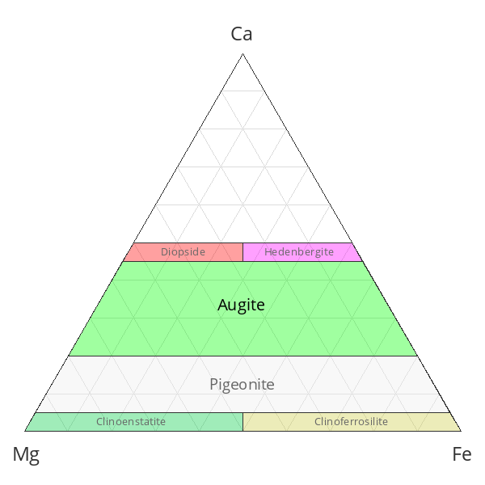
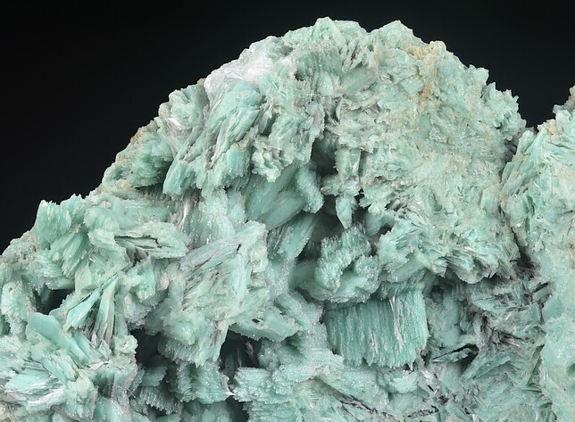
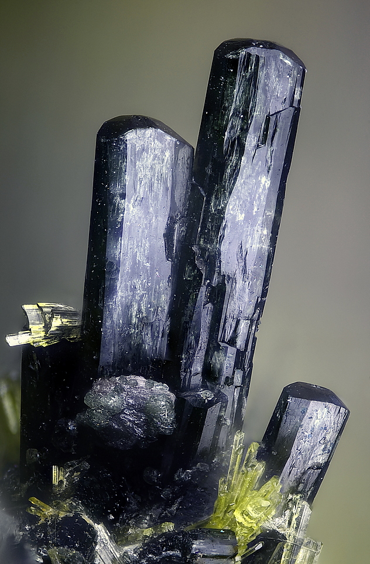

---
tags:
  - minerales
  - resuelto
  - metamorficos-lista
---
Ver [[egirina]], [[Augita]], [[hedenbergita]] y [[diopsida]].

| Tipo                                                                                                        | Mejores marcas de campo | Formula | Especies similares | Ambiente | Otro                                                                                                                                                                                                                                                               |
| ----------------------------------------------------------------------------------------------------------- | ----------------------- | ------- | ------------------ | -------- | ------------------------------------------------------------------------------------------------------------------------------------------------------------------------------------------------------------------------------------------------------------------ |
| Nombre de un subgrupo de minerales monoclínicos [Grupo del piroxeno](https://www.mindat.org/min-9767.html). |                         |         |                    |          | Entre los miembros más extendidos se encuentran la [egirina](https://www.mindat.org/min-31.html), la [augita](https://www.mindat.org/min-419.html), la [hedenbergita](https://www.mindat.org/min-1842.html) y la [diopsida](https://www.mindat.org/min-1294.html). |

| Color | Raya | Brillo | Clivaje (exfoliación) | Dureza relativa (escala de Mohs) | Tenacidad | Peso específico | Diafanidad | Hábito, morfología o forma cristalina. | Fractura | Sistema cristalino | Obs.                                 |
| ----- | ---- | ------ | --------------------- | -------------------------------- | --------- | --------------- | ---------- | -------------------------------------- | -------- | ------------------ | ------------------------------------ |
|       |      |        |                       |                                  |           |                 |            |                                        |          |                    |  |

