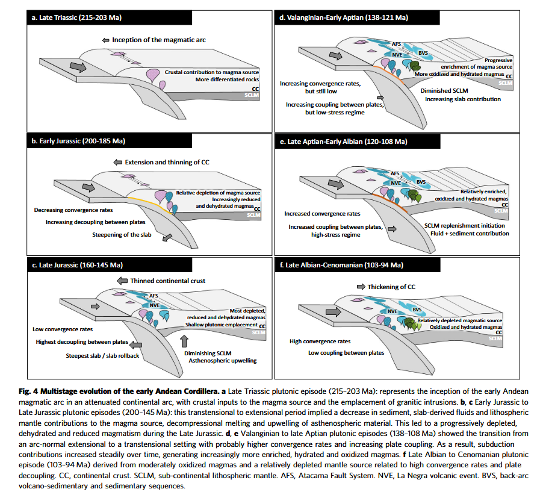

---
tags:
---

Fig. 4 Multistage evolution of the early Andean Cordillera. a Late Triassic plutonic episode (215–203 Ma): represents the inception of the early Andean magmatic arc in an attenuated continental arc, with crustal inputs to the magma source and the emplacement of granitic intrusions. b, c Early Jurassic to Late Jurassic plutonic episodes (200–145 Ma): this transtensional to extensional period implied a decrease in sediment, slab-derived fluids and lithospheric mantle contributions to the magma source, decompressional melting and upwelling of asthenospheric material. This led to a progressively depleted, dehydrated and reduced magmatism during the Late Jurassic. d, e Valanginian to late Aptian plutonic episodes (138–108 Ma) showed the transition from an arc-normal extensional to a transtensional setting with probably higher convergence rates and increasing plate coupling. As a result, subduction contributions increased steadily over time, generating increasingly more enriched, hydrated and oxidized magmas. f Late Albian to Cenomanian plutonic episode (103–94 Ma) derived from moderately oxidized magmas and a relatively depleted mantle source related to high convergence rates and plate decoupling. CC, continental crust. SCLM, sub-continental lithospheric mantle. AFS, Atacama Fault System. NVE, La Negra volcanic event. BVS, back-arc volcano-sedimentary and sedimentary sequences.