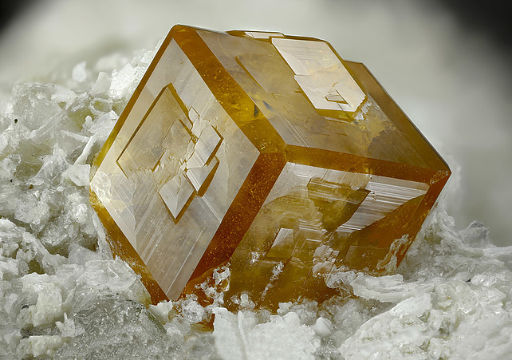
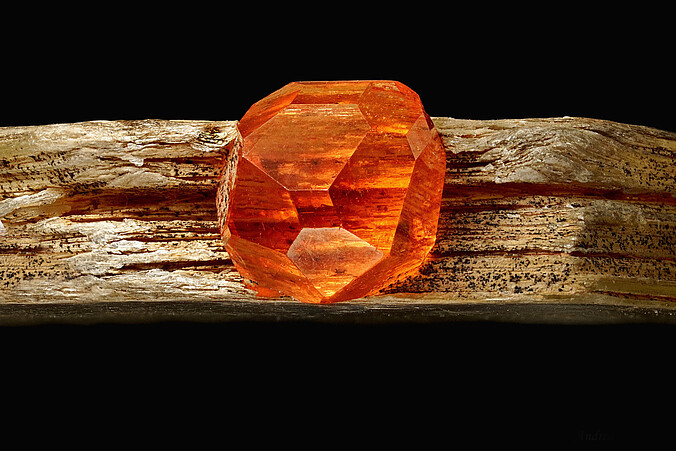

---
tags:
  - minerales
  - metamorficos-lista
  - resuelto
  - grupo-mineral
---

| Tipo                                                                                                                                                                               | Mejores marcas de campo                                                | Formula                                                                                                                                                                                                             | Especies similares                                                                                                                                             | Ambiente                                                                                                                                                                                                                                                                                                                                                                                                                                                                                                                                                                                                                                                                                                                                                                                                                                                                                                                                                                                                                                                          |
| ---------------------------------------------------------------------------------------------------------------------------------------------------------------------------------- | ---------------------------------------------------------------------- | ------------------------------------------------------------------------------------------------------------------------------------------------------------------------------------------------------------------- | -------------------------------------------------------------------------------------------------------------------------------------------------------------- | ----------------------------------------------------------------------------------------------------------------------------------------------------------------------------------------------------------------------------------------------------------------------------------------------------------------------------------------------------------------------------------------------------------------------------------------------------------------------------------------------------------------------------------------------------------------------------------------------------------------------------------------------------------------------------------------------------------------------------------------------------------------------------------------------------------------------------------------------------------------------------------------------------------------------------------------------------------------------------------------------------------------------------------------------------------------- |
| Un grupo de silicatos de aluminio muy cercanamente relacionados ([[piropo]], [[almandina]] y [[espessartina]]) y silicatos de calcio ([[grosular]], [[andradita]] y [[uvarovita]]) | Forma cristalina (generalmente dodecaédrico o trapezoédrico) y dureza. | $$ Mg_{3}Al_{2}Si_{3}O_{12} $$ $$Fe^{2+}_{3}Al_{2}Si_{3}O_{12}$$ $$Mn_{3}Al_{2}Si_{3}O_{12}$$ $$Ca_{3}Al_{2}Si_{3}O_{12} $$ $$ Ca_{3}F^{3+}_{2}Si_{3}O_{12}  $$ $$Ca_{3}Cr_{2}Si_{3}O_{12} $$  | La apatita es más blanda que cualquiera de los granates; el circon tiene una gravedad más alta y a menudo fluoresce; la turmalina tiene una gravedad más baja. | Algunos granates son de origen ígneo, pero la mayoría de ellos son productos de metamorfismo. El piropo se encuentra con olivino y hipersteno en peridotitas de rocas plutónicas. La almandina se encuentra en dioritas de rocas plutónicas, y con andalusita, hornblenda y biotita en hornfels y esquistos de rocas metamórficas de contacto y regionales. La espessartina se encuentra con albita y moscovita en pegmatitas de granito y con cuarzo y riebeckita en esquistos azules de rocas metamórficas regionales. El grosular se encuentra con wollastonita, calcita y vesuvianita en hornfels de rocas metamórficas de contacto. La andradita se encuentra con albita y biotita en pegmatitas de granito; con ortoclasa, calcita, y wollastonita en carbonatitas; con calcita y hedenbergita en hornfels de rocas metamórficas de contacto; y con magnetita y hedenbergita en skarn de rocas metamórficas hidrotermales. Uvarovita ocurre con olivino y cromita en peridotita de rocas plutónicas y en serpentinitas de rocas metamórficas hidrotermales. |

| Color                                                                                                                                                                                                                                                                                                                                                                                                     | Raya     | Brillo | Clivaje (exfoliación)                                       | Dureza relativa (escala de Mohs) | Tenacidad | Peso específico | Diafanidad           | Hábito, morfología o forma cristalina.                                | Fractura             | Sistema cristalino | Obs. |
| --------------------------------------------------------------------------------------------------------------------------------------------------------------------------------------------------------------------------------------------------------------------------------------------------------------------------------------------------------------------------------------------------------- | -------- | ------ | ----------------------------------------------------------- | -------------------------------- | --------- | --------------- | -------------------- | --------------------------------------------------------------------- | -------------------- | ------------------ | ---- |
| Pirópe: rojo profundo a negro rojizo, raramente púrpura o rosa a rojo púrpura pálido (var. rodolita). Almandina: rojo profundo a marrón, negro marronoso. Espesartina: rojo marronoso a rojo jacinto. Grossular: incoloro, blanco, amarillo, rosa, verde, marrón. Andradita: rojo vino, verdoso (var. demantoide), amarillo (var. topazolita), marrón, negro (var. melanita). Uvarovita: verde esmeralda. | Incoloro | Vitreo | Ninguno; separación aveces es distinta en seis direcciones. | 6.5-7.5                          | Fragil    | 3.56-4.32       | Transparente a opaco | dodecahedron, trapezohedron; grnular, lamellar, compacto, diseminado. | concoidal, irregular | Isometrico         |      |

| imagen                               | nota                                                                                                                        |
| ------------------------------------ | --------------------------------------------------------------------------------------------------------------------------- |
|  | [Rosina vein, San Piero in Campo, Campo nell'Elba, Livorno Province, Tuscany, Italy](https://www.mindat.org/loc-56135.html) |
|  | [Chilas, Diamer District, Gilgit-Baltistan, Pakistan](https://www.mindat.org/loc-11487.html)                                |
