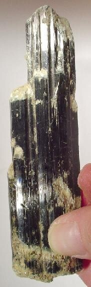

---
tags:
  - minerales
  - resuelto
  - metamorficos-lista
---
Un silicato básico complejo de sodio, potasio, calcio, magnesio, hierro y aluminio, a menudo con algo de titanio; grupo de anfíboles.
Mejores marcas de terreno: Ángulos de exfoliación de 56° y 124°, y color verde oscuro. 
Especies similares: La turmalina carece de la buena exfoliación de la hornblenda, y la tremolita y la actinolita son más claras en color que la hornblenda. 
Ambiente: La hornblenda es un mineral formador de rocas de algunas rocas plutónicas y metamórficas. Es un mineral esencial en granito, granodiorita, diorita y monzonita, y una roca plutónica compuesta en gran parte de hornblenda se llama hornblendita. La hornblenda también está presente en dacita, andesita y basalto de rocas volcánicas, y se encuentra con acmita y nefelina en pegmatitas de nefelina sienita; con albita y epidota en rocas verdes; y con almandina, biotita y corindón en esquistos y gneises de rocas metamórficas regionales.

| Color               | Raya     | Brillo y Clivaje (exfoliación)                                                            | Dureza relativa (escala de Mohs) | Magnetismo | Tenacidad | Tacto | Peso específico | Diafanidad                                      | Olor | Hábito, morfología o forma cristalina.                                                                                      | Fractura                     | Sistema cristalino |
| ------------------- | -------- | ----------------------------------------------------------------------------------------- | -------------------------------- | ---------- | --------- | ----- | --------------- | ----------------------------------------------- | ---- | --------------------------------------------------------------------------------------------------------------------------- | ---------------------------- | ------------------ |
| Verde, cafe, negrro | Incolora | submetalico, vitreo, perlado, sedoso Perfecto, en dos direcciones en forma de diamante | 5-6                              |            | Fragil    |       | 3.0-3.4         | Transparente a translucido en bordes astillados |      | cristales prismáticos que tienen una sección transversal en forma de diamante, tambien granular, columnar, fibroso, radiado | fractura desigual, astillada | Monoclinico        |

