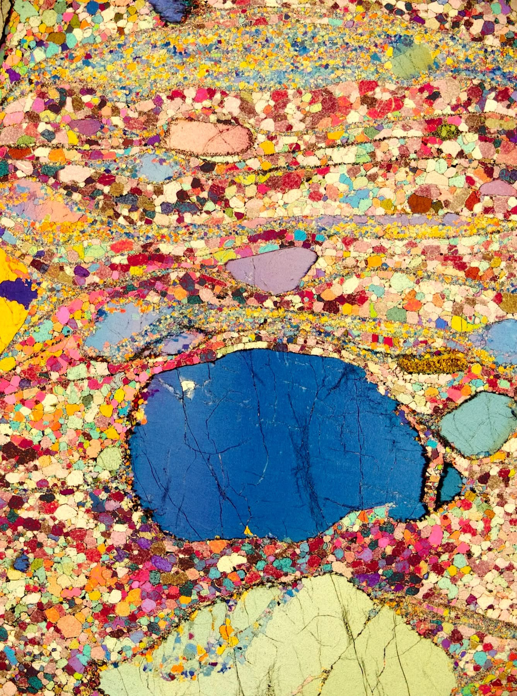

---
tags:
  - minerales
---
Una serie compuesta por dos miembros extremos, forsterita y fayalita, que se presentan como especies separadas; cuando se combinan químicamente forman el silicato de magnesio y hierro comúnmente denominado olivino.

| Tipo                           | Mejores marcas de campo              | Formula                                                                                                  | Especies similares                                                                                                                                         | Ambiente                                                                                                            | Observaciones | Depósitos                                                                                                                                                                                                                                                                                                                                                                           | Asociación                                                                                                                                                                                                                                                                                                            |
| ------------------------------ | ------------------------------------ | -------------------------------------------------------------------------------------------------------- | ---------------------------------------------------------------------------------------------------------------------------------------------------------- | ------------------------------------------------------------------------------------------------------------------- | ------------- | ----------------------------------------------------------------------------------------------------------------------------------------------------------------------------------------------------------------------------------------------------------------------------------------------------------------------------------------------------------------------------------- | --------------------------------------------------------------------------------------------------------------------------------------------------------------------------------------------------------------------------------------------------------------------------------------------------------------------- |
| #silicato de magnesio y hierro | Color amarillo verdoso y yacimiento. | $$ a) Mg_{2}SiO_{4} (forsterita) $$ $$ (Mg,Fe)_{2}SiO_{4}(olivino) $$ $$ b) FeSiO_{4}(Fayalita) $$ | La apatita es más blanda y es fluorescente; la turmalina verde no se encuentra en rocas volcánicas ni en gabros, y el granate verde carece de exfoliación. | El olivino es un mineral formador de rocas y aparece como mineral esencial en el gabro, la peridotita y el basalto. |               | a) En rocas ígneas máficas y ultramáficas y en calizas dolomíticas impuras sometidas a metamorfismo térmico.   b) En rocas volcánicas y plutónicas ultramáficas; con menor frecuencia en rocas plutónicas félsicas; en contadas ocasiones en pegmatitas graníticas; en litofisias de obsidiana. En sedimentos metamorfizados ricos en hierro y en rocas carbonatadas impuras  | a) Enstatita, plagioclasa, flogopita, magnetita, cromita, antigorita, dolomita, brucita, diópsido, corindón, anfiboles, calcita, espinela, augita. b) Augita, plagioclasa, microclina, cuarzo, apatita, magnetita, ilmenita, espinela, hedenbergita, arfvedsonita, anfiboles, almandina, tridimita, grunerita.  |

| Color                                                                                                                                          | Raya     | Brillo | Clivaje (exfoliación)                   | Dureza relativa (escala de Mohs) | Tenacidad | Peso específico | Diafanidad                 | Hábito, morfología o forma cristalina.                                  | Fractura            | Sistema cristalino |
| ---------------------------------------------------------------------------------------------------------------------------------------------- | -------- | ------ | --------------------------------------- | -------------------------------- | --------- | --------------- | -------------------------- | ----------------------------------------------------------------------- | ------------------- | ------------------ |
| Color verde amarillento característico del peridoto, variedad gema del olivino, debido a su contenido de hierro. Marrón amarillento, rojizo | Incolora | Vitreo | Indistinguido, en dos direcciones a 90° | 6.5 - 7                          | Fragil    | 3.2 - 4.3       | Transparente a translucido | Cristales raros; generalmente en granos redondeados y masas granulares. | desigual, concoidal | ortorrómbico       |

| imagen                               | nota                                                                                                                                                                                                                                                                                                                                              |
| ------------------------------------ | ------------------------------------------------------------------------------------------------------------------------------------------------------------------------------------------------------------------------------------------------------------------------------------------------------------------------------------------------- |
|  | [  ### Olivine Group, Basalt  Hanson Quarry, Kulnura, Northumberland County, New South Wales, Australia  Peridot crystal (Olivine group) in Basalt found by my son and given to me.      ](https://www.mindat.org/photo-1587185.html) |
|                     | peridotita con granate cizallada; puros olivinos.                                                                                                                                                                                                                                                                                                 |

