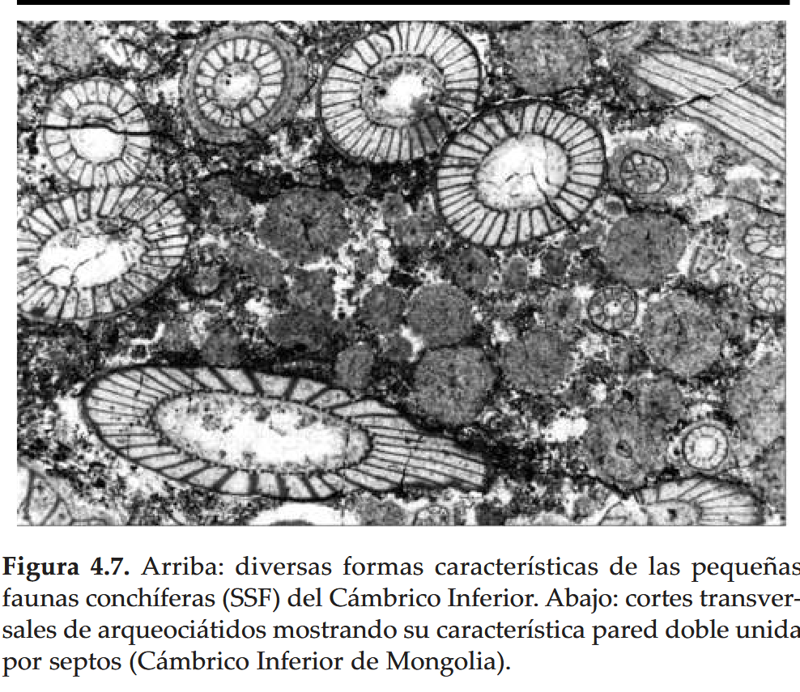

---
tags:
---
Dob's Linn is important in geology as the location of the [Global Boundary Stratotype Section and Point](https://en.wikipedia.org/wiki/Global_Boundary_Stratotype_Section_and_Point "Global Boundary Stratotype Section and Point") (GSSP)[[3]](https://en.wikipedia.org/wiki/Dob's_Linn#cite_note-3) which marks the boundary between the [Ordovician](https://en.wikipedia.org/wiki/Ordovician "Ordovician") and [Silurian](https://en.wikipedia.org/wiki/Silurian "Silurian") periods

". La planta vascular más antigua conocida es Cooksonia, (Fig. 5.24, 1-2) encontrada en capas del Silúrico Superior de varias regiones del mundo (Gales, Apalaches, este de Europa, Bolivia). En ningún ejemplar se han preservado los rizomas debido a que en todos los casos se trata de restos transportados. Estas plantas, sin embargo, no fueron las primeras en colonizar la tierra firme. Hay registros de esporas de plantas terrestres que se remontan al Ordovícico Medio, aunque esto no implica necesariamente la existencia de plantas vasculares (o traqueófitas)"

"La transición a la tierra firme implicó una serie de importantes transformaciones anatómicas y funcionales, como el desarrollo de un tallo relativamente rígido (aparición del xilema) para mantener la planta erguida, una cutícula impermeable para evitar la pérdida de agua por evaporación, aunque con pequeñas perforaciones o estomas que se abren periódicamente para permitir el ingreso de CO2 utilizado en la nutrición, un sistema de fijación al suelo (raíces o rizomas) y que además capta agua y sales, un sistema de transporte del agua a las células (sistema vascular) y, finalmente, un sistema de reproducción basado en esporas que pueden ser dispersadas por el viento"

"Entre los organismos planctónicos que florecieron en el Ordovícico y que continuaron su evolución en el Silúrico y Devónico están los conodontes y los graptolitos."

"Lapworth incluyó en el Sistema Ordovícico una sucesión de rocas expuestas en los montes Arenig, en el norte de Gales, que eran claramente distinguibles del resto por sus faunas de braquiópodos, trilobites y graptolitos"
#### Silúrico

" Los descensos del nivel del mar se los ha vinculado con el crecimiento del casquete glaciario de Gondwana. A modo de ejemplo, durante el denominado evento Ireviken (definido en Báltica), del Wenlockiano inferior, la temperatura del agua de mar descendió alrededor de 6°C en las regiones subtropicales, dato calculado en base a la rela"ción isotópica dO18. Loydell (2007), basado en datos cronológicos poco concluyentes, postuló que las diamictitas de la Formación Cancañiri serían producto de esta glaciación."
"Como vimos en § 5.3, alrededor del límite Ordovícico/Silúrico se depositaron las diamictitas de origen glacial de la Formación Cancañiri, las que alcanzan espesores de más de 1500 m"