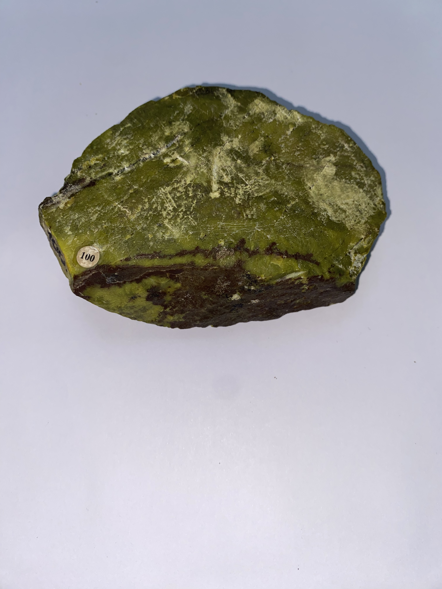

---
tags:
  - md
---

| Tipo | Mejores marcas de campo | Formula | Especies similares | Ambiente | Observaciones | Depósitos | Asociación |
| ---- | ----------------------- | ------- | ------------------ | -------- | ------------- | --------- | ---------- |
| Grupo mineral Está compuesto por antigorita y crisótilo, ambos silicatos de magnesio básicos con una fórmula similar; el crisótilo contiene algo de hierro | Dureza baja. Cualquier masa rocosa de color verde oscuro, con una dureza de 3 a 4 y una sensación grasa al tacto, puede sospecharse que contiene los minerales del grupo de la serpentina. La crisotilo es blanda y flexible. | $(Mg,Fe)_{3}Si_{2}O_{5}(OH)_{4}$ | Los minerales serpentinos son más duros que el talco, pero más blandos que la nefrita. El crisótilo es más blando y más flexible que el amianto tremolita. | Los minerales serpentina son los constituyentes principales de la roca serpentinita, que generalmente se forma a partir de peridotita mediante procesos metamórficos hidrotermales. |  |  |  |

| Color | Raya | Brillo | Clivaje (exfoliación) | Dureza relativa (escala de Mohs) | Tenacidad | Peso específico | Diafanidad | Hábito, morfología o forma cristalina. | Fractura | Sistema cristalino |
| ----- | ---- | ------ | --------------------- | -------------------------------- | --------- | --------------- | ---------- | -------------------------------------- | -------- | ------------------ |
| Verde oliva, negruzco a verde amarillento, marrón, amarillo, raramente blanco | Blanca | Graso, ceroso, sedoso (crisotilo) | Ninguna (crisotilo); micácea perfecta (antigorita). | 3-5 | Quebradiza | 2,5 a 2,6 |  | La antigorita no se conoce en cristales, generalmente es masiva y aparece criptocristalina. El crisotilo es fibroso; también laminar y columnar; las fibras son flexibles y tenaces. | Concoidal (antigorita), irregular, astillosa (crisotilo) | Monoclínico |

| imagen | nota |
| ------ | ---- |
|  |  |
