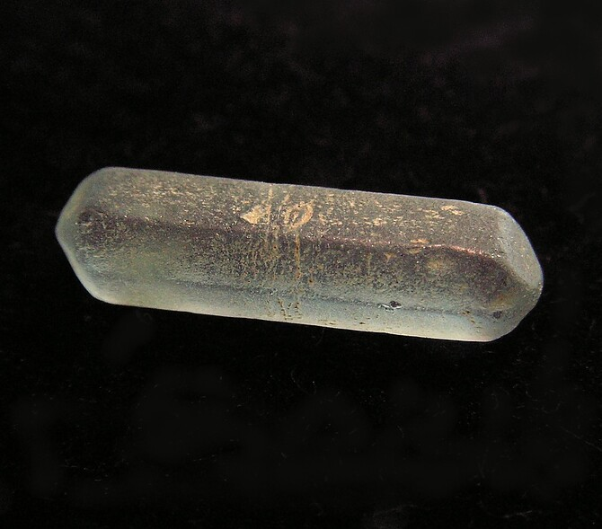

---
tags:
  - minerales
  - metamorficos-lista
  - resuelto
---

Silicato de aluminio $$ Al_{2}SiO_{5} $$
Mejores marcas de terreno: Dureza y fragilidad
Especies similares: La sillimanita es más dura y más quebradiza que la tremolita, el crisotilo y minerales fibrosos similares.
Ambiente: La sillimanita es un mineral metamórfico y se encuentra generalmente en esquistos y gneises de rocas metamórficas regionales, donde ocurre junto con almandina, biotita y cuarzo.

| Color                                    | Raya                                                                                                | Brillo          | Clivaje (exfoliación)                                    | Dureza relativa (escala de Mohs) | Tenacidad                 | Peso específico | Diafanidad                 | Hábito, morfología o forma cristalina.                                                      | Fractura | Sistema cristalino | Obs. |
| ---------------------------------------- | --------------------------------------------------------------------------------------------------- | --------------- | -------------------------------------------------------- | -------------------------------- | ------------------------- | --------------- | -------------------------- | ------------------------------------------------------------------------------------------- | -------- | ------------------ | ---- |
| Blanco grisáceo, marrón, marrón verdoso, | Incolora, de acuerdo con (Chesterman & 1913-, s. f.) / Blanca de acuerdo con handbook of mineralogy | Vitreo, sedoso, | Perfecto, en una dirección en sentido del lado más largo | 6-7                              | Resistente en su conjunto | 3.2-3.3         | Transparente a translucido | generalmente masas fibrosas, columnar, radiante; cristales prismáticos distintos son raros. | Desigual | Ortorombico        |      |

