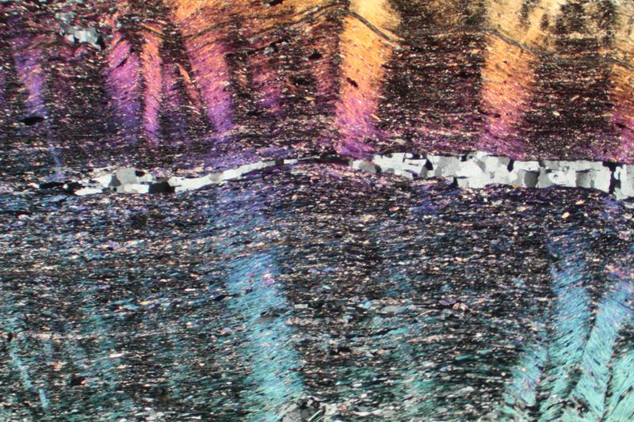

---
tags:
  - textura
  - metamorficas
---
# Textura lepidoblástica

Una textura lepidoblástica es una textura metamórfica en la que los minerales laminares o tabulares se alinean para formar una estructura plana. La pizarra, la filita y el esquisto presentan texturas lepidoblásticas. Esta textura se debe a la orientación paralela, durante la recristalización, de minerales con un hábito laminar o escamoso, como la mica y la clorita.
# Lepidoblastic Texture

A lepidoblastic texture is a metamorphic texture in which platy or tabular minerals are aligned to produce a planar fabric. Slate, phyllite and schist all have lepidoblastic textures. This texture is due to the parallel orientation during recrystallization of minerals with a flaky or scaly habit, e.g. mica and chlorite.

Blandly creanulated lepidoblastic muscovite layers. XPL image, 2x (Field of view = 7mm)