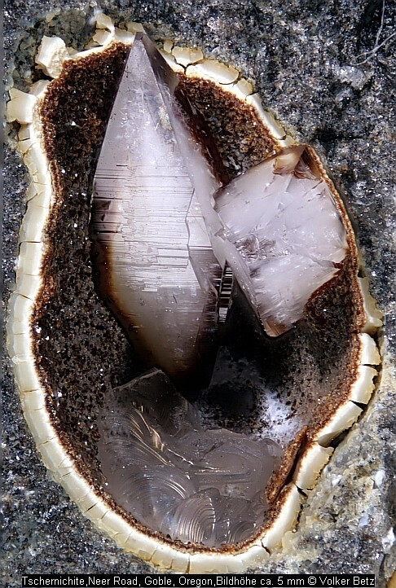
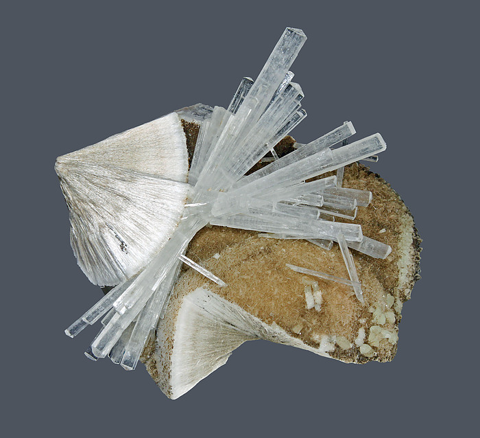

---
tags:
  - minerales
  - metamorficos-lista
  - grupo-mineral
  - resuelto
---
==Las zeolitas son un grupo de minerales tectosilicatos hidratados relacionados, populares entre los coleccionistas, que comúnmente se encuentran en cavidades de rocas ígneas básicas, especialmente en basaltos vesiculares. Contienen agua en canales microscópicos dentro de un marco de unidades de silicato de aluminio; el agua puede ser eliminada (por calor) o reemplazada sin alterar la estructura de los minerales de zeolita==

| Tipo                                                                                                      | Mejores marcas de campo                                                                        | Formula                                         | Especies similares                                                                                                                                                                                                       | Ambiente                                                                                                                                                                                                                                                                                               |
| --------------------------------------------------------------------------------------------------------- | ---------------------------------------------------------------------------------------------- | ----------------------------------------------- | ------------------------------------------------------------------------------------------------------------------------------------------------------------------------------------------------------------------------ | ------------------------------------------------------------------------------------------------------------------------------------------------------------------------------------------------------------------------------------------------------------------------------------------------------ |
|                                                                                                           |                                                                                                | $$  $$                                          |                                                                                                                                                                                                                          |                                                                                                                                                                                                                                                                                                        |
| Heulandite: Silicato hidratado de sodio, calcio, potasio y aluminio; el potasio puede sustituir al sodio. | Forma cristalina, brillo vítreo y nacarado, y asociación con otras zeolitas.                   | $$ (Ca,Na)(Al_{2}Si_{7}O_{18}) \cdot 6H_{2}O $$ | La estilbita tiene la forma de manojo de trigo, y la apofilita no tiene ni la forma de manojo de trigo ni la forma de ataúd.                                                                                             | La heulandita es un mineral de baja presión y comúnmente se desarrolla en cavidades en basaltos. Generalmente se asocia con calcita y otros zeolitas.                                                                                                                                                  |
| Estilbita Silicato hidratado de calcio, sodio y aluminio; grupo de zeolitas.                              | Agregados en forma de gavilla de trigo y su asociación con otros minerales zeolíticos.         |                                                 | La forma de racimo de trigos bastará para distinguir la estilbita de la heulandita y la apofilita. Además, los cristales de apofilita presentan caras estriadas, que no se observan en la estilbita.                     | La estilbita se forma a bajas presiones y generalmente en cavidades de algunas rocas plutónicas o volcánicas, comúnmente asociada con calcita y otras zeolitas.                                                                                                                                        |
| Laumontita: Silicato de calcio y aluminio hidratado                                                       | Superficie blanca y polvorienta en el mineral debido a la pérdida de agua.                     |                                                 | La apofilita y la heulandita no tienen una superficie en polvo blanca.                                                                                                                                                   | Laumontita se forma a temperaturas relativamente bajas y se desarrolla en cavidades en basaltos de rocas volcánicas junto con calcita y zeolitas. Recientemente se ha encontrado en cavidades en hornfels de rocas metamórficas de contacto, asociadas con grosular, epidota, scheelita y molibdenita. |
| Chabazita Hidrosilicato de calcio, sodio y aluminio, generalmente con algo de sodio y potasio             | Cristales romboédricos, contorno pseudocúbico y falta de brillo perlado en las fracturas.      |                                                 | El contorno romboédrico y la falta de brillo perlado en las fracturas son suficientes para distinguir la chabazita de la heulandita y la analcima; la calcita se puede distinguir por su efervescencia en ácido diluido. | La chabazita se forma a bajas temperaturas y generalmente se asocia con zeolitas y calcita en cavidades en basaltos de rocas volcánicas.                                                                                                                                                               |
| Analcima (Analcita) Silicato de sodio y aluminio hidratado                                                | Ocurrencia como cristales brillantes y transparentes que recubren cavidades.                   |                                                 | Los cristales de leucita tienen un brillo mate, y el granate de color pálido es más duro que la analcima.                                                                                                                | La analcima suele formarse en cavidades del basalto de las rocas volcánicas y se asocia con zeolitas, calcita y prehnita.                                                                                                                                                                              |
| Natrolita Silicato de sodio y aluminio hidratado                                                          | Forma cristalina, dureza y clivaje prismático                                                  |                                                 | Los cristales de natrolita son más gruesos que los de mesolita, y la natrolita es más dura que el yeso prismático.                                                                                                       | La natrolita suele encontrarse con los minerales zeolitas, calcita y prehnita en cavidades en basaltos.                                                                                                                                                                                                |
| Mesolita Silicato hidratado de sodio, calcio y aluminio                                                   | Ocurrencia habitual en grupos de cristales finos, sedosos y en forma de aguja de color blanco. |                                                 | La mesolita es ligeramente más blanda y más ligera que la natrolita, pero debido a su hábito fibroso y acicular, las pruebas útiles para la dureza y la gravedad específica son difíciles de realizar.                   | La mesolita es un mineral de baja temperatura y comúnmente se encuentra asociado con datolita, prehnita y zeolitas en cavidades en basaltos de rocas volcánicas.                                                                                                                                       |

| Zeolita             | Color                                                               | Raya     | Brillo                        | Clivaje (exfoliación)                                      | Dureza relativa (escala de Mohs) | Tenacidad | Peso específico | Diafanidad                 | Hábito, morfología o forma cristalina.                                                                                                                                                                    | Fractura                  | Sistema cristalino | obs.                                                                                                                                                                                                                                                                                                                                                                                                  |
| ------------------- | ------------------------------------------------------------------- | -------- | ----------------------------- | ---------------------------------------------------------- | -------------------------------- | --------- | --------------- | -------------------------- | --------------------------------------------------------------------------------------------------------------------------------------------------------------------------------------------------------- | ------------------------- | ------------------ | ----------------------------------------------------------------------------------------------------------------------------------------------------------------------------------------------------------------------------------------------------------------------------------------------------------------------------------------------------------------------------------------------------- |
| Heulandita          | Blanco, grisaceo, incoloro, verdoso, rojo.                          | Incolora | Vitreo, perlado en el clivaje | Perfecto una dirección                                     | 3.5-4                            | Fragil    | 2.2             | Transparente a translucido | generalmente en cristales individuales en forma de ataúd o tabulares; agregados radiales de cristales casi paralelos; también foliados, globulares, granulares.                                           | irregular                 | Monoclinico        |                                                                                                                                                                                                                                                                                                                                                                                                       |
| Estilbita           | Blanco, grisaceo, amarillento, rojo a marrón                        | incolora | Vitreo, perlado en clivaje    | Perfecto, una dirección                                    | 3.5-4                            | Fragil    | 2.1-2.2         | Transparente a translucido | comúnmente en agregados en forma de cuchilla de numerosos cristales geminados, estrangulados en el medio para parecer manojos de trigo; también radiales, globulares, raramente como cristales tabulares. | irregular                 | monoclinico        | Presencia: Mineral hidrotermal de baja temperatura que se encuentra en amígdalas y cavidades de basaltos, andesitas y diversas rocas metamórficas. Se forma en yacimientos de aguas termales y actúa como agente cementante en algunas areniscas y conglomerados.                                                                                                                                     |
| Laumontita          | Blanco, sin color, amarillento, marrón                              | incolora | Vitreo                        | Perfecto, en dos direcciones                               | 4                                | Fragil    | 2.2-2.3         | Transparente a translucido | generalmente cristales prismáticos cortos con terminaciones oblicuas; también masivos y recientemente encontrados en cristales prismáticos largos de hasta 7.5 cm (3") de longitud.                       | irregular                 | Monoclinico        | Occurrencia: De origen hidrotermal, recubre cavidades en rocas ígneas. Pueden formarse gruesos estratos sedimentarios ricos en laumontita a raíz de la descomposición de la analcima o del metamorfismo del plagioclasa. Puede ser autigénica, cementando areniscas.                                                                                                                                  |
| Chabazita           | Blanco, amarillo, rosado, rojo                                      | Blanca   | Vitreo                        | Pobre en tres direcciones, paralela en las caras del rombo | 4-5                              | fragil    | 2.0-2.2         | transparente a translucida | generalmente romboedros que se asemejan a cubos porque los ángulos entre las caras están cerca de 90°; también compactos, que suelen mostrar maclas de penetración.                                       | irregular                 | Hexagonal          |                                                                                                                                                                                                                                                                                                                                                                                                       |
| Analcima (Analcita) | Blanco, incoloro, gris, con tintes verdosos, amarillentos, rojizos. | Incolora | Vitreo                        | Ninguno                                                    | 5-5.5                            | Fragil    | 2.2-2.3         | transparente a translucida | generalmente como trapezoedros simples; también granulares, compactos.                                                                                                                                    | irregular a sub-concoidal | Isometrico         | Presencia: En la masa fundamental o en las vesículas de rocas ígneas intermedias y mágicas pobres en sílice, típicamente basaltos y fonolitos, procedente de soluciones hidrotermales de fase tardía, o diseminado debido a la alteración deuterica. En lechos lacustres, alterado a partir de materiales piroclásticos o arcillas, o como precipitado primario; autigénico en areniscas y limolitas. |
| Natrolita           | Blanco, incoloro, verdoso, amarillento, rojizo                      | Incoloro | Vitreo, sedoso                | perfecto, en una dirección                                 | 5-5.5                            | Fragil    | 2.2-2.3         | transparente a translucido | comúnmente delgadas a aciculares; también radiales, granulares, compactas; comúnmente en grupos radiantes, revestiendo cavidades en rocas volcánicas                                                      | irregular                 | Ortorombico        | Presencia: En cavidades de basaltos amigdaloidales y rocas ígneas afines, es uno de los últimos minerales en formarse; rellena vetas en granito, gneis y sienita.                                                                                                                                                                                                                                     |

| imagen                               | nota                                                                                                                                                                |
| ------------------------------------ | ------------------------------------------------------------------------------------------------------------------------------------------------------------------- |
|  | [Tschernichite](https://www.mindat.org/min-4037.html)  [Neer Road, Goble, Columbia County, Oregon, USA](https://www.mindat.org/loc-19733.html)                |
|  | [Millington Quarry, Bernards Township, Somerset County, New Jersey, USA](https://www.mindat.org/loc-3952.html)[Natrolite](https://www.mindat.org/min-2947.html)  |
