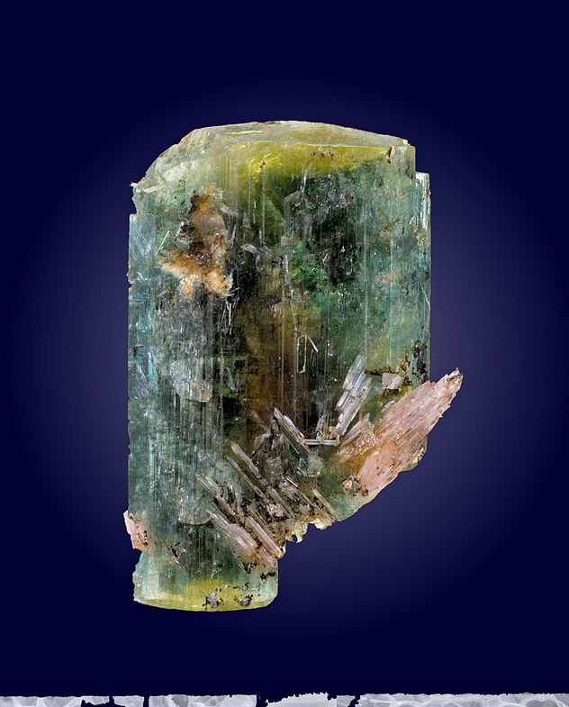
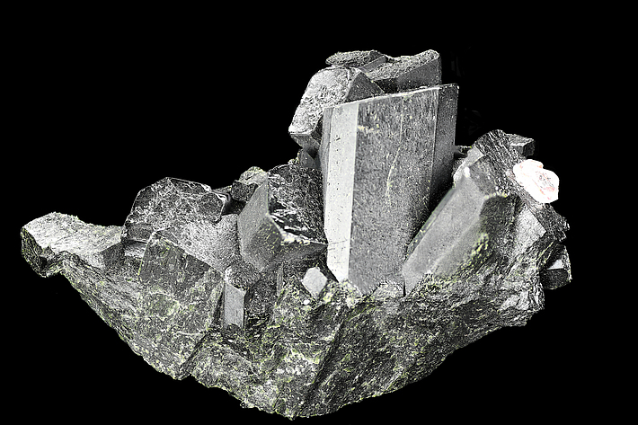

---
tags:
  - minerales
  - metamorficos-lista
  - resuelto
---

| Tipo                        | Mejores marcas de campo                                                     | Formula               | Especies similares                                                                                                                                                          | Ambiente                                                                                                                                                                                                                                    |
| --------------------------- | --------------------------------------------------------------------------- | --------------------- | --------------------------------------------------------------------------------------------------------------------------------------------------------------------------- | ------------------------------------------------------------------------------------------------------------------------------------------------------------------------------------------------------------------------------------------- |
| Silicato de hierro y calcio | Color verde oscuro, ángulos de clivaje de 87° y 93°, y minerales asociados. | $$ CaFeSi_{2}O_{6} $$ | La hedenbergita es de un verde más oscuro que la epidota y el diopsido y tiene una perfecta clivaje prismático en dos direcciones, que la epidota y la turmalina no tienen. | La hedenbergita se forma en rocas metamórficas y se encuentra con grosularia, wollastonita y magnetita en hornfels de rocas metamórficas de contacto, y con andradita, magnetita y actinolita en skarn de rocas metamórficas hidrotermales. |

| Color                                 | Raya                     | Brillo        | Clivaje (exfoliación)                                                                                 | Dureza relativa (escala de Mohs) | Tenacidad | Peso específico | Diafanidad                 | Hábito, morfología o forma cristalina.                                                                                                                  | Fractura                       | Sistema cristalino | Obs. |
| ------------------------------------- | ------------------------ | ------------- | ----------------------------------------------------------------------------------------------------- | -------------------------------- | --------- | --------------- | -------------------------- | ------------------------------------------------------------------------------------------------------------------------------------------------------- | ------------------------------ | ------------------ | ---- |
| Verde brillante a verde oscuro, negro | incoloro a verde pálido. | Vitreo o mate | Bueno/Perfecto, dos direcciones a lo largo en ángulos casi rectos; la separación a veces es distinta. | 5.5-6.5                          | Fragil    | 3.3-3.6         | Translucido a Transparente | Cristales prismáticos cortos, de hasta 5 cm. En agregados columnares o aciculares; granulares, laminares, masivos. Macla: macla simple y polisintética. | Irregular/desigual, conchoidal | Monoclinico        |      |

| imagen                               | nota                                                                                                                                             |
| ------------------------------------ | ------------------------------------------------------------------------------------------------------------------------------------------------ |
|  | [Southern operations Mine, Broken Hill, Broken Hill district, Yancowinna Co., New South Wales, Australia](https://www.mindat.org/loc-10307.html) |
|  |  Malmberget, Gällivare, Norrbotten County, Sweden                                                                                             |
