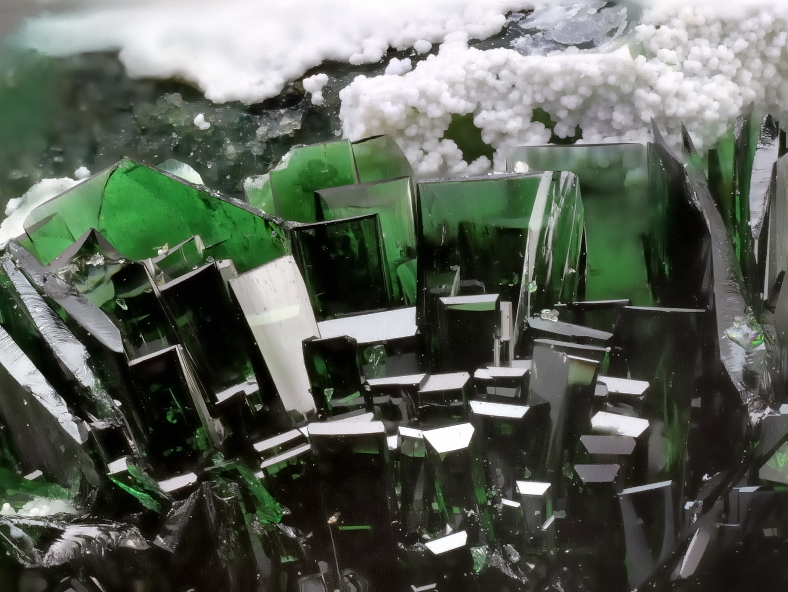
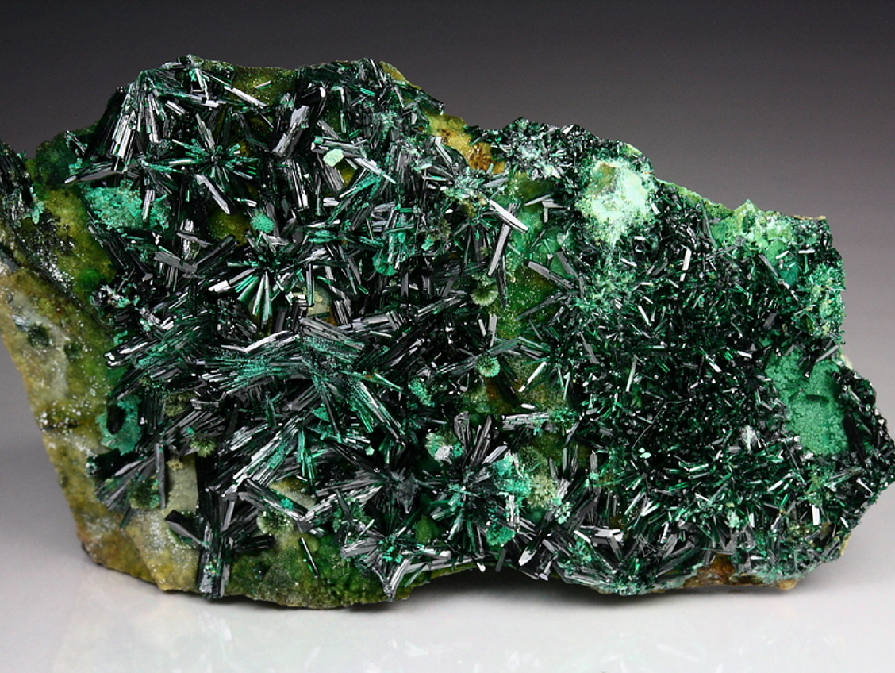
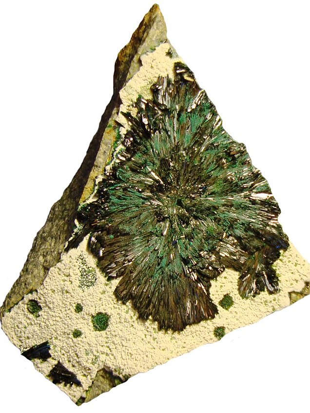

---
tags:
  - minerales
---
Mineral secundario de cobre que se forma mediante la oxidación de otros minerales de cobre, especialmente en condiciones áridas y salinas. Puede confundirse con la [brochantita](https://www.mindat.org/min-779.html).  
  
Puede transformarse en [malaquita](https://www.mindat.org/min-2550.html) y [crisocola](https://www.mindat.org/min-1040.html), dando lugar a pseudomorfos.

| Tipo            | Formula                | Mejores marcas de campo | Especies similares | Ambiente | Depósitos                                                                                                                                                                                                                                                                                   | Asociación                                                                                    | Observaciones                                                                                                                                                                                                                                                                                   |
| --------------- | ---------------------- | ----------------------- | ------------------ | -------- | ------------------------------------------------------------------------------------------------------------------------------------------------------------------------------------------------------------------------------------------------------------------------------------------- | --------------------------------------------------------------------------------------------- | ----------------------------------------------------------------------------------------------------------------------------------------------------------------------------------------------------------------------------------------------------------------------------------------------- |
| grupo atacamita | $$ Cu_{2}Cl(OH)_{3} $$ |                         |                    |          | Un producto de oxidación de otros minerales de cobre, especialmente en condiciones áridas y salinas; en yacimientos fumarólicos; un producto de la meteorización de sulfuros en yacimientos submarinos de «fumarolas negras»; una alteración de objetos de bronce y cobre de la Antigüedad. | Cuprita, brochantita, linarita, caledonita, malaquita, crisocola, paratacamita, botallackita. | En Chile, originaria de una localidad no definida del desierto de Atacama; actualmente se conoce su presencia en numerosos lugares, como Copiapó, Carrizal, Tierra Amarilla y Remolinos, en Atacama; y Collahurasi, en Tarapacá. Polimórfico con botallackita, clinoatacamita y paratacamita |

| Fuente                                                                 | Color                                                 | Brillo             | Raya          | Dureza relativa (escala de Mohs) | Clivaje (exfoliación)                         | Peso específico | Fractura  | Diafanidad                 | Tenacidad | Sistema cristalino | Hábito, morfología o forma cristalina.                                                                                                                                                                                                                                                                                                                                                                                                              |
| ---------------------------------------------------------------------- | ----------------------------------------------------- | ------------------ | ------------- | -------------------------------- | --------------------------------------------- | --------------- | --------- | -------------------------- | --------- | ------------------ | --------------------------------------------------------------------------------------------------------------------------------------------------------------------------------------------------------------------------------------------------------------------------------------------------------------------------------------------------------------------------------------------------------------------------------------------------- |
| The Audubon Society field guide to North American rocks and minerals   |                                                 |                    |               |                                  |                                               |                 |           |                            |           |                    |                                                                                                                                                                                                                                                                                                                                                                                                                                                     |
| [Handbook of Mineralogy](https://handbookofmineralogy.org/pdf-search/) | Verde-amarillo, verde-esmeralda-oscuro a verde-oscuro |                    | verde-manzana |                                  | Exposición: {010}, perfecta; {101}, aceptable |                 | Concoidal | Transparente a translucido |           |                    | Cristales delgados, de hasta 10 cm, prismáticos a lo largo de [001]; estriados k [001], en {010}k [110]; comúnmente tabulares ⊥{010} o pseudooctaédricos con {110} y {011}. Fibrosos, de granulometría arenosa a compactos, masivos. Macla: plano de macla {110}, plano de composición {110}, poco frecuente; alrededor de [544], más común. De la macla se derivan dobletes, tripletes —tanto de contacto como de penetración— y grupos complejos. |
| [mindat](https://www.mindat.org/)                                      |                                                       | Adamantino, vitreo |               | 3.0 - 3.5                        |                                               | 3.745 - 3.776   |           |                            |           | Ortorrómbico       |                                                                                                                                                                                                                                                                                                                                                                                                                                                     |

| imagen                                       | nota                                                                                                                                                                                                                                                                                                                                                                                                                        |
| -------------------------------------------- | --------------------------------------------------------------------------------------------------------------------------------------------------------------------------------------------------------------------------------------------------------------------------------------------------------------------------------------------------------------------------------------------------------------------------- |
|    | [  ### Atacamite, Halloysite  La Farola Mine, Cerro Pintado, Las Pintadas mining district, Tierra Amarilla, Copiapó Province, Atacama, Chile  Nice, dark emerald-green atacamite crystals with white halloysite aggregates.  © Harald Biecker      ](https://www.mindat.org/photo-931316.html)            |
|          | [  ### Atacamite, Chrysocolla  La Farola Mine, Cerro Pintado, Las Pintadas mining district, Tierra Amarilla, Copiapó Province, Atacama, Chile  Atacamite completely covering the host base with some blue-green Chrysocolla.  © Quebul Fine Minerals      ](https://www.mindat.org/photo-477855.html)     |
|          | [  ### Atacamite, Libethenite, Halloysite  La Farola Mine, Cerro Pintado, Las Pintadas mining district, Tierra Amarilla, Copiapó Province, Atacama, Chile  Great Atacamite sun accompanied by Libethenite on Halloysite. Roberto Rojas R. Personal Collection.      ](https://www.mindat.org/photo-282690.html) |

