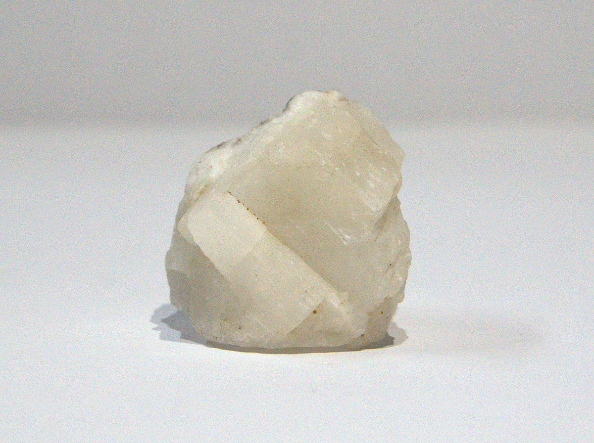
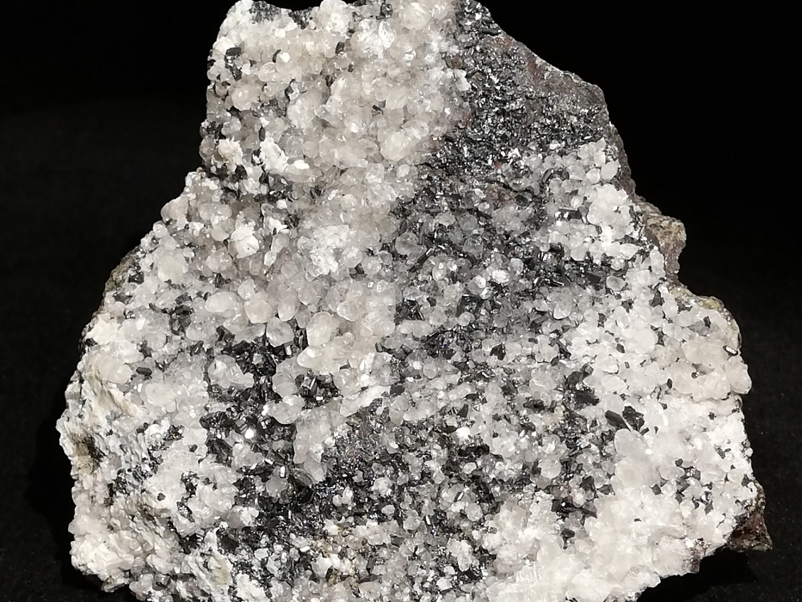

---
tags:
  - minerales
---

| Tipo                | Mejores marcas de campo                                                                                                                                                            | Formula        | Especies similares                                                                                                         | Ambiente                                                                                                                                                                                                                                                                                                                                                                                                                                                                                                                                                                                                                                                                                                                                                                                                                    | Observaciones                   | Depósitos                                                                                                                                                                                                                                                     | Asociación                                                                                                                                                                                                                                            |
| ------------------- | ---------------------------------------------------------------------------------------------------------------------------------------------------------------------------------- | -------------- | -------------------------------------------------------------------------------------------------------------------------- | --------------------------------------------------------------------------------------------------------------------------------------------------------------------------------------------------------------------------------------------------------------------------------------------------------------------------------------------------------------------------------------------------------------------------------------------------------------------------------------------------------------------------------------------------------------------------------------------------------------------------------------------------------------------------------------------------------------------------------------------------------------------------------------------------------------------------- | ------------------------------- | ------------------------------------------------------------------------------------------------------------------------------------------------------------------------------------------------------------------------------------------------------------- | ----------------------------------------------------------------------------------------------------------------------------------------------------------------------------------------------------------------------------------------------------- |
| Carbonato de calcio | Clivaje romboédrico perfecto y dureza; efervesce vigorosamente en ácido; doble refracción en muestras claras (un objeto visto a través del cristal aparece como una imagen doble). | $$ CaCO_{3} $$ | La aragonita carece de la exfoliación romboédrica. Se requieren pruebas ópticas para distinguir la calcita de la dolomita. | La calcita es el más común de todos los minerales carbonatados y se forma en muchos tipos de entornos. Se encuentra  junto a acmita, apatita y fluorita en pegmatitas de sienita nefelínica; junto a barita, albita y escapolita en carbonatitas; junto a zeolitas y prehnita en basaltos de rocas volcánicas; con yeso y caliza en rocas sedimentarias químicas y orgánicas; con tremolita y wollastonita en hornfels de rocas metamórficas de contacto; con grossularia, wollastonita y diópsido en hornfels y mármoles de rocas metamórficas regionales; con hedenbergita y andradita en el skarn de rocas metamórficas hidrotermales; con cuarzo, dolomita y fluorita en vetas hipotérmicas, mesotérmicas y epitermales; y con cerusita, marcasita y esfalerita en yacimientos de sustitución hidrotérmica diseminados. | Cristales maclados muy comunes. | Mineral importante en la formación de rocas; presente en calizas, mármoles y tizas; cemento habitual en rocas sedimentarias clásticas; y como ganga en vetas hidrotermales; presente en rocas ígneas alcalinas a máficas; habitual como espeleotema en cuevas | Dolomita, celestina, fluorita, barita, pirita, marcasita, esfalerita (vetas de baja temperatura); zeolitas, calcedonia, «clorita» (vesículas); talco, tremolita, grossularia, cuarzo (metamórficas); nefelina, diópsido, apatita, ortoclasa (ígneas). |

| Color                                                                                                  | Raya   | Brillo       | Clivaje (exfoliación)                                | Dureza relativa (escala de Mohs) | Tenacidad | Peso específico | Diafanidad           | Hábito, morfología o forma cristalina.                                                                                                                                         | Fractura  | Sistema cristalino |
| ------------------------------------------------------------------------------------------------------ | ------ | ------------ | ---------------------------------------------------- | -------------------------------- | --------- | --------------- | -------------------- | ------------------------------------------------------------------------------------------------------------------------------------------------------------------------------ | --------- | ------------------ |
| Blanco, incoloro, tonos pálidos de gris, amarillo, rojo, verde, azul, marrón a negro cuando es impuro. | Blanca | Vitreo, mate | Perfecto en tres direcciones, formando un rombohedro | 3                                | Frágil    | 2.7             | Transparente a opaco | cristales que comúnmente muestran romboedros, escalenoedros y prismas; también tabulares, aciculares, exfoliables, granulares, compactos, estalactíticos, oolíticos, terrosos; | concoidal | Hexagonal          |

| imagen                               | nota                                                                                                                                                                                                                                                                                                                                                                                                               |
| ------------------------------------ | ------------------------------------------------------------------------------------------------------------------------------------------------------------------------------------------------------------------------------------------------------------------------------------------------------------------------------------------------------------------------------------------------------------------ |
|  | [  ### Calcite  Arica, Arica Province, Arica y Parinacota, Chile  Specimen of calcite found in Arica, with its characteristic whitish color, visible rhombohedral geometric shapes, and a vitreous luster that highlights its crystalline structure.      ](https://www.mindat.org/photo-1434311.html) |
|  | [  ### Calcite, Chalcocite  Manto Cobriza Mine, Copiapó, Copiapó Province, Atacama, Chile  Calcite with nice sharp lustrous chalcocite crystals covers one side of the specimen.      ](https://www.mindat.org/photo-1211862.html)                                                                     |

