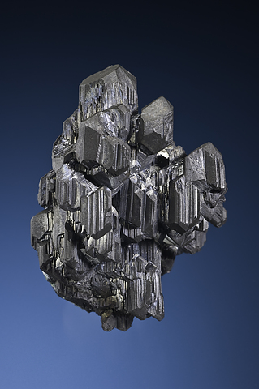

---
tags:
  - minerales
---
| Tipo             | Mejores marcas de campo                                                                                          | Formula       | Especies similares                                                                                            | Ambiente                                                                                                                                                                                                                                                                                                                                                                                |
| ---------------- | ---------------------------------------------------------------------------------------------------------------- | ------------- | ------------------------------------------------------------------------------------------------------------- | --------------------------------------------------------------------------------------------------------------------------------------------------------------------------------------------------------------------------------------------------------------------------------------------------------------------------------------------------------------------------------------- |
| Sulfuro de cobre | De color gris; menos sectil que otros minerales de sulfuro; asociado a otros minerales de cobre; muy quebradizo. | $$ Cu_{2}S $$ | La calcocita es menos frangible que la acantita; no presenta la exfoliación de la galena; y es de color gris. | La calcocita, uno de los minerales de cobre más abundantes, se encuentra en varios entornos distintos, especialmente junto a la galena, la pirita y el cuarzo en vetas mesotérmicas; junto al cobre nativo y la calcita en basalto de rocas volcánicas; y junto con la calcopirita, la bornita y la pirita en yacimientos de sustitución hidrotermal masivos, filonianos y diseminados. |

| Color                                      | Raya                | Brillo   | Clivaje (exfoliación)   | Dureza relativa (escala de Mohs) | Tenacidad | Peso específico | Diafanidad | Hábito, morfología o forma cristalina.                                                   | Fractura   | Sistema cristalino | Obs. |
| ------------------------------------------ | ------------------- | -------- | ----------------------- | -------------------------------- | --------- | --------------- | ---------- | ---------------------------------------------------------------------------------------- | ---------- | ------------------ | ---- |
| Gris plomo oscuro; al oxidarse, negro mate | gris oscuro a negro | metálico | Pobre, en una dirección | 2.5 - 3                          | Fragil    | 5.5 - 5.8       | Opaco      | prismático corto o tabular, estriado en una cara; también granular compacto, diseminado. | conchoidal | Ortorombico        |      |

| imagen                               | nota                                                                                                    |
| ------------------------------------ | ------------------------------------------------------------------------------------------------------- |
|  | [Bristol Copper Mine, Bristol, Hartford County, Connecticut, USA](https://www.mindat.org/loc-3698.html) |
