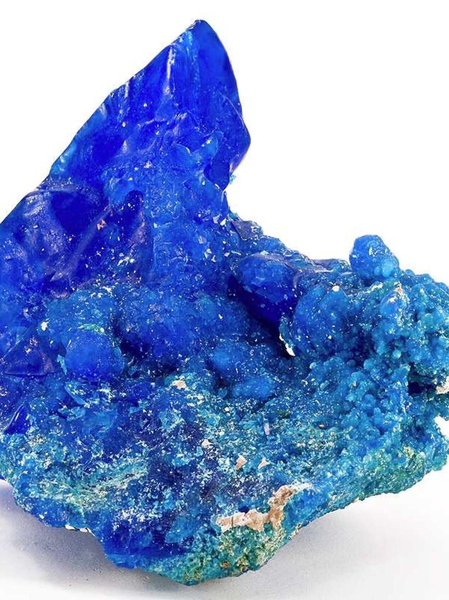
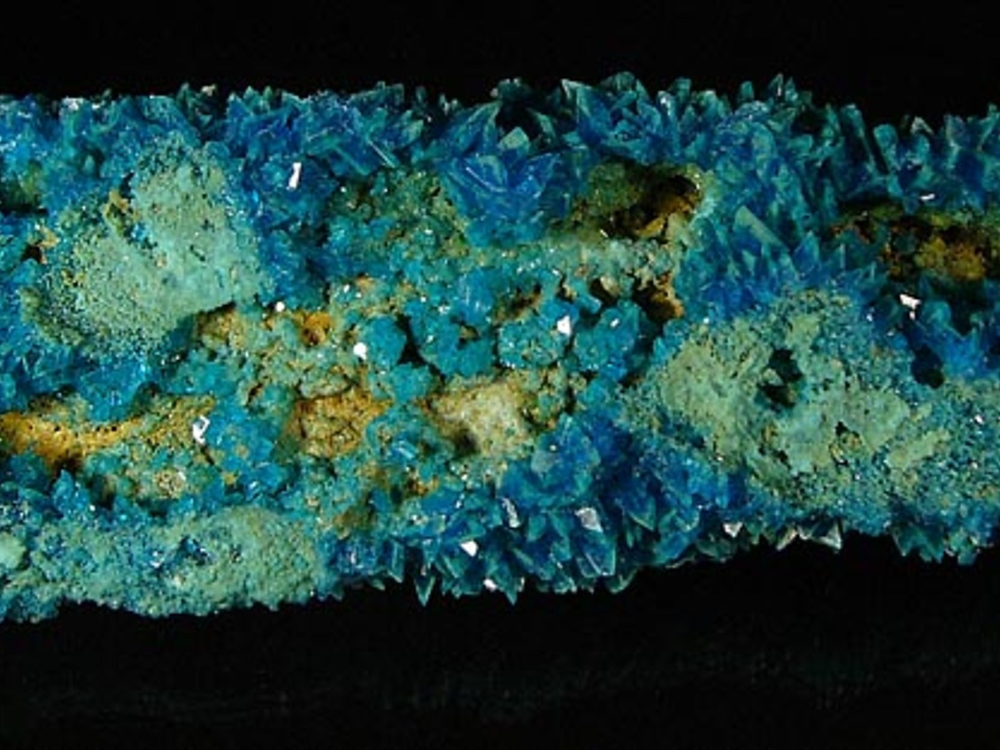
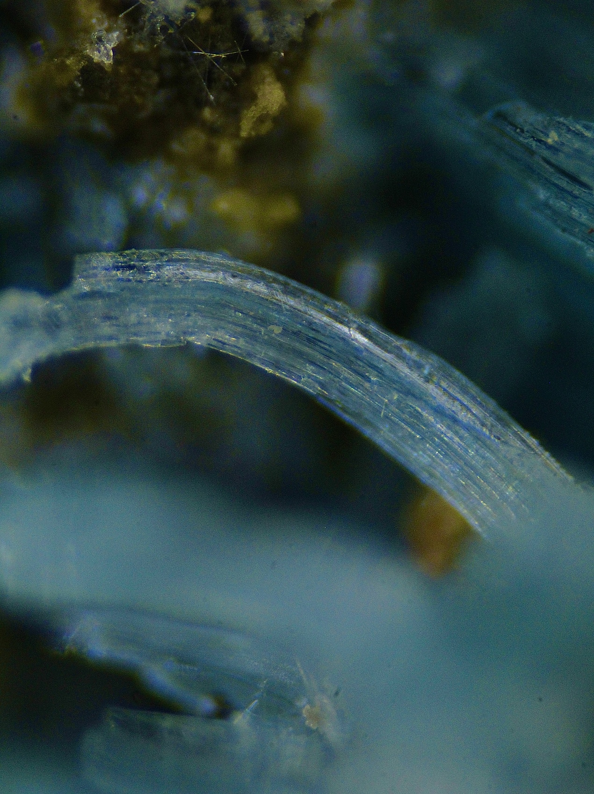

---
tags:
  - minerales
---

| Tipo                      | Formula                    | Mejores marcas de campo                                     | Especies similares                                            | Ambiente                                                                                                                                                                                                                                                                                                                              | Depósitos                                                                                                                                                                                          | Asociación                                                                                                            | Observaciones                                                                                                         |
| ------------------------- | -------------------------- | ----------------------------------------------------------- | ------------------------------------------------------------- | ------------------------------------------------------------------------------------------------------------------------------------------------------------------------------------------------------------------------------------------------------------------------------------------------------------------------------------- | -------------------------------------------------------------------------------------------------------------------------------------------------------------------------------------------------- | --------------------------------------------------------------------------------------------------------------------- | --------------------------------------------------------------------------------------------------------------------- |
| Sulfato cúprico hidratado | $$ CuSO_{4}\cdot H_{2}O $$ | Se disuelve fácilmente en agua y produce una solución azul. | La melanterita es verde, mientras que la calcanthita es azul. | La chalcanthita es un mineral secundario de cobre que se forma cerca de la superficie en la zona de alteración en todo tipo de depósitos de reemplazo hidrotermales; comúnmente se asocia con aragonito y calcita. Debido a la fácil solubilidad de la chalcanthita en agua, los ejemplares finos deben ser preservados de inmediato. | Mineral secundario presente en las partes oxidadas de los yacimientos de sulfuro de cobre, que suele formarse tras la explotación minera; rara vez se encuentra en forma de yacimiento fumarólico. | : melanterita, fibroferrita, romboclasa, epsomita, goslarita, pickeringita, retgersita, morenosita, brochantita, yeso | Chalcanthite group.  *sabor metálico ligeramente dulce (prueba el sabor con precaución: el mineral es tóxico).* |

| Fuente                                                                 | Color                                                                                        | Brillo       | Raya   | Dureza relativa (escala de Mohs) | Clivaje (exfoliación) | Peso específico | Fractura            | Diafanidad                | Tenacidad | Sistema cristalino | Hábito, morfología o forma cristalina.                                                                                        |
| ---------------------------------------------------------------------- | -------------------------------------------------------------------------------------------- | ------------ | ------ | -------------------------------- | --------------------- | --------------- | ------------------- | ------------------------- | --------- | ------------------ | ----------------------------------------------------------------------------------------------------------------------------- |
| The Audubon Society field guide to North American rocks and minerals   | Azul profundo, azul cielo, azul verdoso                                                | vitreo, mate | Blanca | 2.5                              | Definido              | 2.28            | concoidal, terrosa, | translucido a trasparente |           | Triclinic          | generalmente cristales prismáticos cortos, menos comúnmente cristales tabulares gruesos; también incrustantes, estalactíticos |
| [Handbook of Mineralogy](https://handbookofmineralogy.org/pdf-search/) | de azul de Berlín a azul cielo, azul verdoso; de incoloro a azul pálido a la luz transmitida |              |        |                                  |                       |                 |                     |                           |           |                    |                                                                                                                               |
| [mindat](https://www.mindat.org/)                                      |                                                                                              |              |        |                                  |                       |                 |                     |                           | Fragil    |                    |                                                                                                                               |

| imagen                                       | nota                                                                                                                                                                                                                                                                                                                                                                                                                                                                                                                                                                                                                                                            |
| -------------------------------------------- | --------------------------------------------------------------------------------------------------------------------------------------------------------------------------------------------------------------------------------------------------------------------------------------------------------------------------------------------------------------------------------------------------------------------------------------------------------------------------------------------------------------------------------------------------------------------------------------------------------------------------------------------------------------- |
|    | [  ### Chalcanthite  Teniente Mine, El Teniente, Rancagua, Cachapoal Province, O'Higgins, Chile  13.4 x 11.3 x 8.7 cm. This is the largest and best crystallized natural chalcanthite that I have personally seen. It has a huge complete crystal of neon blue, sticking straight up from matrix. It is pristine, glows when backlit, and is from an old-time locality. Chalcanthite is easily synthesized today and grown in labs all around the world for ...  © Rob Lavinsky & irocks.com      ](https://www.mindat.org/photo-202061.html) |
|          | [  ### Chalcanthite  Chuquicamata Mine, Chuquicamata District, Calama, El Loa Province, Antofagasta, Chile  Nice chalcanthite sitting on sediment. Crystals up to 5mm; sample 15x5cm.  © Zbynek Burival      ](https://www.mindat.org/photo-41162.html)                                                                                                                                                                                                                                                                                       |
|          | [  ### Chalcanthite  Maria Catalina mine, Pampa Larga mining district, Tierra Amarilla, Copiapó Province, Atacama, Chile  A sample of Chalcantite is shown in a cavity with various crystals of this mineral, it was a rare discovery of the waste that is found inside this mine since there is no mineralogy that indicates the presence of copper sulfates. Alejandro Castro Villafaña  © Alejandro Castro Villafaña      ](https://www.mindat.org/photo-1295777.html)                                                                     |

