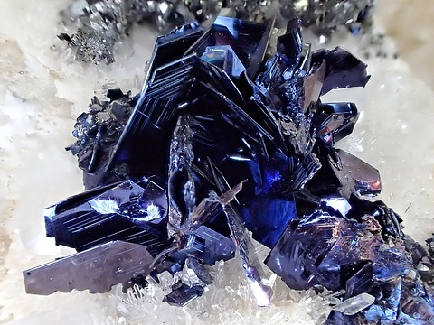

---
tags:
  - minerales
---
| Tipo                                                           | Mejores marcas de campo                                                                                                                                                        | Formula   | Especies similares                                                                                                                                                                                             | Ambiente                                                                                                                                                                                                                                                                      |
| -------------------------------------------------------------- | ------------------------------------------------------------------------------------------------------------------------------------------------------------------------------ | --------- | -------------------------------------------------------------------------------------------------------------------------------------------------------------------------------------------------------------- | ----------------------------------------------------------------------------------------------------------------------------------------------------------------------------------------------------------------------------------------------------------------------------- |
| Sulfuro de cobre, a menudo con una pequeña cantidad de hierro. | Características laminares, color azul (que no debe confundirse con la película iridiscente presente en la calcopirita y la bornita) y asociación con otros minerales de cobre. | $$ CuS $$ | Cuando la calcopirita y la bornita están recubiertas por una película iridiscente de color azul intenso (que se puede eliminar fácilmente con un golpe seco de martillo), podrían confundirse con la covelita. | La covelita no es un mineral común, pero, cuando se encuentra, aparece junto con la calcopirita y la pirita en yacimientos de sustitución hidrotermal masivos y filonianos, y junto con la pirita, la bornita y la calcopirita en skarns de rocas metamórficas hidrotermales. |

| Color                                                                                                             | Raya                    | Brillo      | Clivaje (exfoliación)   | Dureza relativa (escala de Mohs) | Tenacidad                               | Peso específico | Diafanidad | Hábito, morfología o forma cristalina.                                                               | Fractura  | Sistema cristalino | Obs.                                                             |
| ----------------------------------------------------------------------------------------------------------------- | ----------------------- | ----------- | ----------------------- | -------------------------------- | --------------------------------------- | --------------- | ---------- | ---------------------------------------------------------------------------------------------------- | --------- | ------------------ | ---------------------------------------------------------------- |
| Azul índigo oscuro o más oscuro a menudo iridiscente, con reflejos violáceos, rojo intenso y amarillo cobrizo. | del gris plomo al negro | submetalico | Perfecto, una dirección | 1.5 - 2                          | laminas delgadas flexibles; quebradizas | 4.6 a 4.8       | Opaco      | raramente en buenos cristales; comúnmente masivo, menos comúnmente diseminado y en costras delgadas. | irregular | Hexagonal          | a menudo muy iridiscente, en tonos amarillo latón y rojo intenso |

| imagen                               | nota                                                                                           |
| ------------------------------------ | ---------------------------------------------------------------------------------------------- |
|  | [Butte Mining District, Silver Bow County, Montana, USA](https://www.mindat.org/loc-3873.html) |
