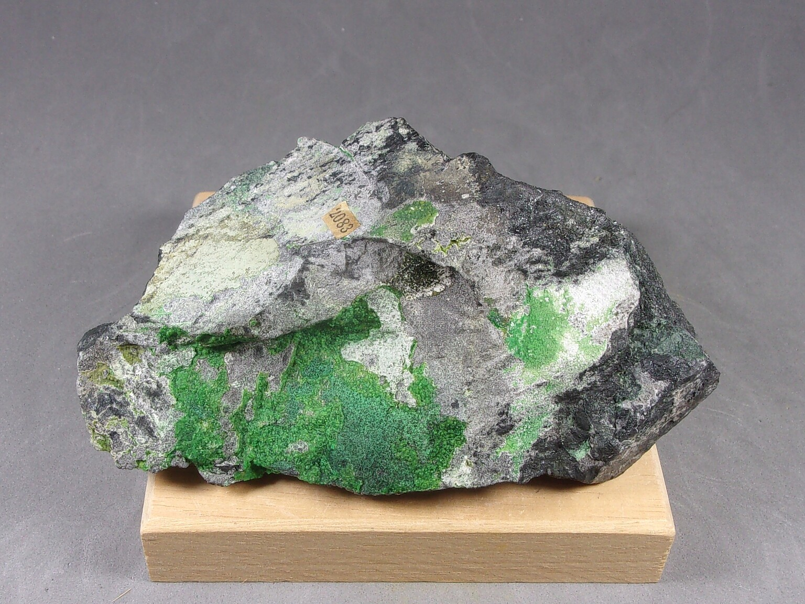

---
tags:
  - minerales
---
| Tipo                    | Mejores marcas de campo         | Formula             | Especies similares                                                             | Ambiente                                                                                                                                                                                                                                                                                                                                                                                                     | Observaciones |
| ----------------------- | ------------------------------- | ------------------- | ------------------------------------------------------------------------------ | ------------------------------------------------------------------------------------------------------------------------------------------------------------------------------------------------------------------------------------------------------------------------------------------------------------------------------------------------------------------------------------------------------------ | ------------- |
| Óxido de cromo y hierro | Raya oscura y magnetismo débil. | $$ FeCr_{2}O_{4} $$ | La magnetita es fuertemente magnética, y el espinela no tiene una raya oscura. | La cromita es de origen ígneo y se forma en peridotita de rocas plutónicas. También se encuentra en serpentinitas, pero dado que la serpentinitas se desarrolló a través de la alteración hidrotermal de la peridotita, la cromita en la peridotita original permanece sin cambios y aparece como un componente de la serpentinitas. La uvarovita, el granate de cromo, se asocia comúnmente con la cromita. |               |

| Color                                    | Raya         | Brillo                                             | Clivaje (exfoliación)                                | Dureza relativa (escala de Mohs) | Tenacidad | Peso específico | Diafanidad          | Hábito, morfología o forma cristalina.                                         | Fractura                                  | Sistema cristalino |
| ---------------------------------------- | ------------ | -------------------------------------------------- | ---------------------------------------------------- | -------------------------------- | --------- | --------------- | ------------------- | ------------------------------------------------------------------------------ | ----------------------------------------- | ------------------ |
| Negro-hierro, negro-marronezco, metálico | Negra marrón | Submetálico y mate, resinoso, metálico, grasiento. | Ninguno, partición en cuatro direcciones indefinida. | 5.5                              | Frágil    | 4.3 - 5.0       | Transparente, opaco | cristales octaédricos, raros; generalmente diseminados, granulares, compactos. | irregular/desigual, dentada, subconcoidal | Isométrico         |

| imagen                               | nota                                                                                                                                                                                                                                                                                                                                                                                                                                                                                                                                                                                 |
| ------------------------------------ | ------------------------------------------------------------------------------------------------------------------------------------------------------------------------------------------------------------------------------------------------------------------------------------------------------------------------------------------------------------------------------------------------------------------------------------------------------------------------------------------------------------------------------------------------------------------------------------ |
|  | [  ### Chromite, Zaratite  Lancaster County, Pennsylvania, USA  From Deyrolle, Paris, France. It is a dense mass of Chromite with surface alteration on one side of the piece. The interest lies not only in the Chromite but also in the green color of the Zaratite. We already know that “Zaratite” is a mineral in question, as it appears to be more of a mixture of nickel carbonates. However, the name has ...      ](https://www.mindat.org/photo-1675640.html) |
