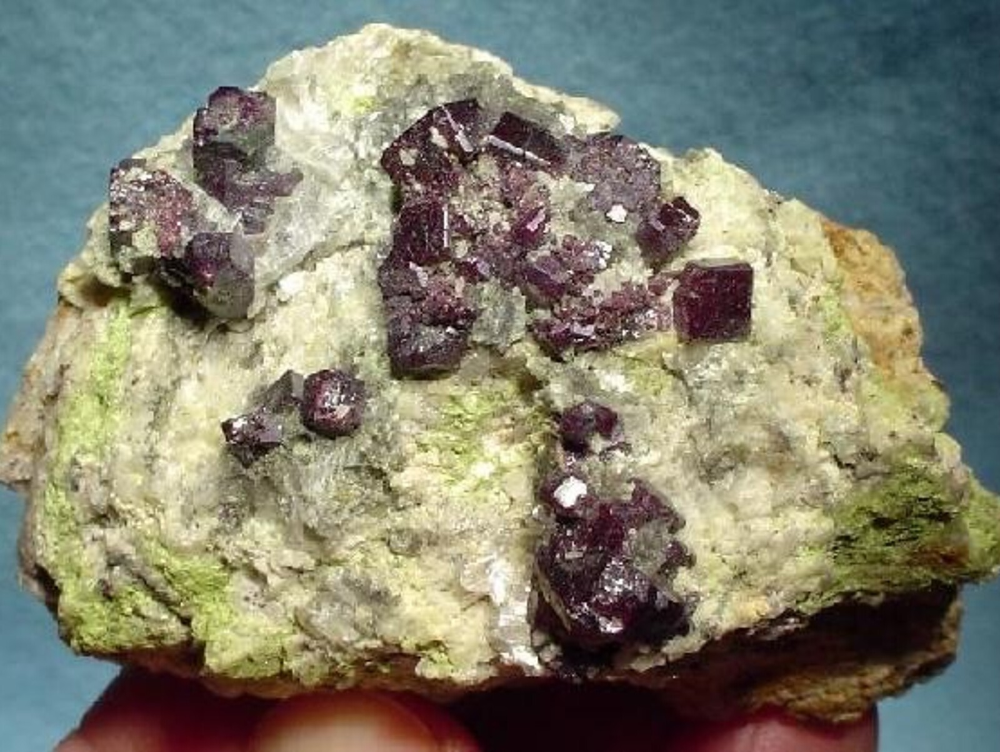

---
tags:
  - minerales
---

| Tipo           | Mejores marcas de campo   | Formula      | Especies similares                                                                                                                                                                                                                                             | Ambiente                                                                                                                                                                                        | Observaciones | Asociación                                                                                                                         | Depósitos                                                              |
| -------------- | ------------------------- | ------------ | -------------------------------------------------------------------------------------------------------------------------------------------------------------------------------------------------------------------------------------------------------------- | ----------------------------------------------------------------------------------------------------------------------------------------------------------------------------------------------- | ------------- | ---------------------------------------------------------------------------------------------------------------------------------- | ---------------------------------------------------------------------- |
| Oxido de cobre | Forma cristalina y dureza | $$ Cu_{2}O$$ | La cuprita se forma en cristales con forma octaédrica, mientras que los de pirargirita son prismáticos; el realgar se forma en cristales prismáticos monoclínicos y tiene una gravedad menor; y la zincita generalmente se asocia con willemita y franklinita. | La cuprita es un mineral secundario de cobre y se forma en la zona de alteración en depósitos de reemplazo hidrotermales diseminados, donde se encuentra con cobre nativo, malaquita y calcita. |               | Cobre, tenorita, malaquita, azurita, calcita, brochantita, antlerita, atacamita, crisocola, óxidos de hierro, minerales arcillosos | Un mineral común en las zonas oxidadas de muchos yacimientos de cobre. |

| Color                          | Raya            | Brillo                           | Clivaje (exfoliación) | Dureza relativa (escala de Mohs) | Tenacidad | Peso específico | Diafanidad                 | Hábito, morfología o forma cristalina.                                                                                                                                                                                                                                                 | Fractura             | Sistema cristalino |
| ------------------------------ | --------------- | -------------------------------- | --------------------- | -------------------------------- | --------- | --------------- | -------------------------- | -------------------------------------------------------------------------------------------------------------------------------------------------------------------------------------------------------------------------------------------------------------------------------------- | -------------------- | ------------------ |
| Rojo-rubí, rojo negro-rojiento | Roja-marronezca | Submetálico, adamantino, terroso | Pobre                 | 3.5 - 4.0                        | Frágil    | 6.1             | Transparent to translucent | generalmente octaédrico, menos a menudo dodecaédrico o cúbico; también compacto, granular, terroso, capilar (calcotricita); en forma de capilares similares a cabellos, de sección cuadrada, reticulados, en mechones y enmarañados; también terrosos, granulares compactos y masivos. | Irregular, concoidal | Isometrico         |

| imagen                               | nota                                                                                                                                                                                                                                                                                                                                                                                                                                                                                                                                                                                                                                                                  |
| ------------------------------------ | --------------------------------------------------------------------------------------------------------------------------------------------------------------------------------------------------------------------------------------------------------------------------------------------------------------------------------------------------------------------------------------------------------------------------------------------------------------------------------------------------------------------------------------------------------------------------------------------------------------------------------------------------------------------- |
|  | [  ### Cuprite  Chuquicamata Mine, Chuquicamata District, Calama, El Loa Province, Antofagasta, Chile  6.5 x 4.4 x 3.7 cm. An OUTSTANDING example of a RARE occurrence, specimen-grade cuprite crystals from the famous Chuquicamata Mine of Chile. And this showy piece is RICHLY covered with lustrous, deep wine-red crystals to 8 mm. Nearly all of the major cuprites are pristine, excepting the bit of periphery bruising to the large crystal. This is an ...  © Rob Lavinsky & irocks.com      ](https://www.mindat.org/photo-130371.html) |
