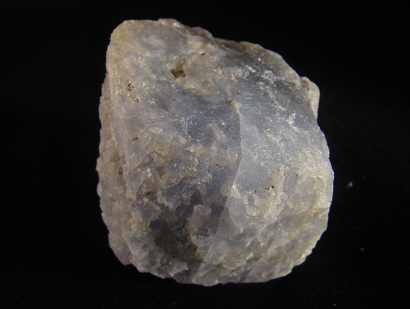
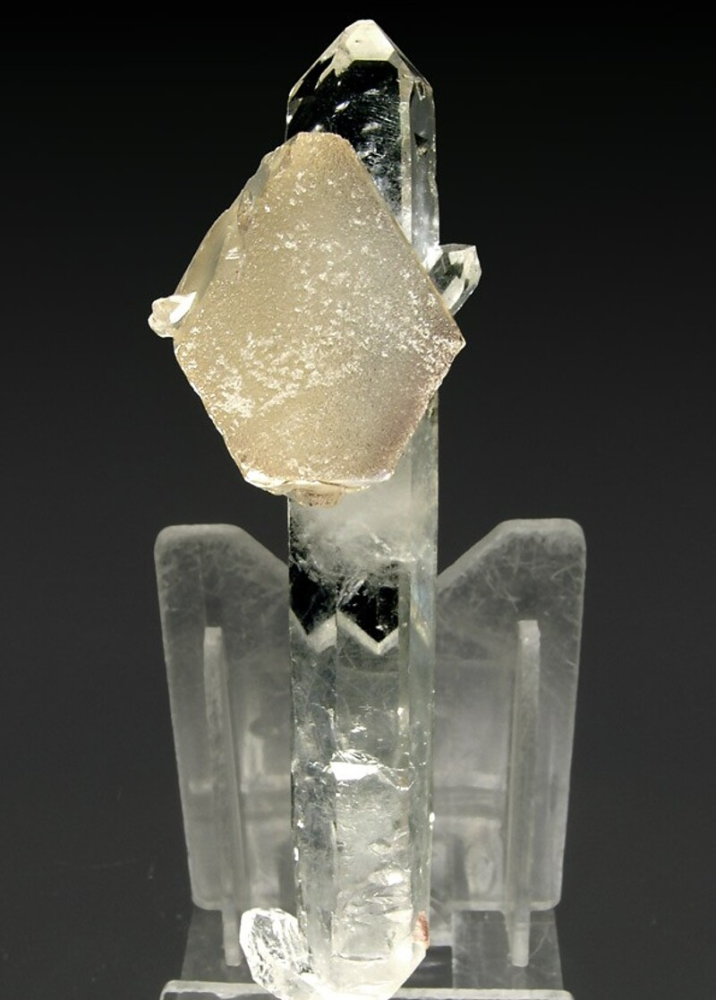

---
tags:
  - minerales
---

| Tipo                                                                                      | Mejores marcas de campo                                             | Formula                | Especies similares                                                                                                                                         | Ambiente                                                                                                                                                                                                                                                                                                                                                                                           | Observaciones | Depósitos                                                                                                                                                                                                                                                                                                                  | Asociación                                                                                                                                                                                                                                                                                              |
| ----------------------------------------------------------------------------------------- | ------------------------------------------------------------------- | ---------------------- | ---------------------------------------------------------------------------------------------------------------------------------------------------------- | -------------------------------------------------------------------------------------------------------------------------------------------------------------------------------------------------------------------------------------------------------------------------------------------------------------------------------------------------------------------------------------------------- | ------------- | -------------------------------------------------------------------------------------------------------------------------------------------------------------------------------------------------------------------------------------------------------------------------------------------------------------------------- | ------------------------------------------------------------------------------------------------------------------------------------------------------------------------------------------------------------------------------------------------------------------------------------------------------- |
| carbonato de calcio y magnesio; a veces contiene cantidades menores de manganeso y hierro | Superficies curvas y brillo perlado; el polvo efervescerá en ácido. | $$ CaMg(CO_{3})_{2} $$ | A diferencia de la calcita, la dolomita rara vez fluoresce y se distingue además por sus caras curvas, su brillo perlado y una densidad ligeramente mayor. | El mineral dolomita se desarrolla en varios entornos. Ocurre con barita y fluorita en roca de dolomita de rocas sedimentarias químicas; con calcita en mármol dolomítico de rocas metamórficas de contacto y regionales; con calcita, siderita y rodocrosita en vetas hipoterma, mesotérmica y epiterma; y con galena, calcita y yeso en depósitos masivos y diseminados de reemplazo hidrotermal. |               | Se forma por diagénesis o metasomatismo hidrotermal de la piedra caliza; constituye una fase primaria en entornos sedimentarios hipersalinos; es un componente principal de algunas rocas metamórficas de contacto y mármoles; actúa como ganga en vetas hidrotermales; se encuentra en carbonatitas y rocas ultramáficas. | Fluorita, barita, calcita, siderita, cuarzo, sulfuros metálicos (hidrotermales); calcita, celestina, yeso, cuarzo (sedimentarios); talco, serpentina, magnesita, calcita, magnetita, diópsido, tremolita, forsterita, wollastonita (metamórficas); calcita, ankerita, siderita, apatita (carbonatitas). |

| Color                                              | Raya   | Brillo          | Clivaje (exfoliación)                                | Dureza relativa (escala de Mohs) | Tenacidad | Peso específico | Diafanidad                 | Hábito, morfología o forma cristalina.                                                                                      | Fractura             | Sistema cristalino |
| -------------------------------------------------- | ------ | --------------- | ---------------------------------------------------- | -------------------------------- | --------- | --------------- | -------------------------- | --------------------------------------------------------------------------------------------------------------------------- | -------------------- | ------------------ |
| Blanco, incoloro, rosa, gris, verde, marrón, negro | Blanca | Vitreo, perlado | Perfecto en tres direcciones, formando un rombohedro | 3.5 - 4.0                        | Frágil    | 2.8 - 2.9       | Transparente a translucido | comúnmente romboédrico, con caras curvas; también granular, compacto, masivo (como la roca de dolomita) y masas de clivaje. | Concoidal, irregular | Hexagonal          |

| imagen                               | nota                                                                                                                                                                                                                                                                                                                                                                                                                                                                                                                                                                                                                                                             |
| ------------------------------------ | ---------------------------------------------------------------------------------------------------------------------------------------------------------------------------------------------------------------------------------------------------------------------------------------------------------------------------------------------------------------------------------------------------------------------------------------------------------------------------------------------------------------------------------------------------------------------------------------------------------------------------------------------------------------- |
|  | [  ### Dolomite  Alto Chapare mining district, Chapare Province, Cochabamba, Bolivia  6cm, pale blue, crude rhombohedral dolomite crystal from the Locotal Breccia Formation. Blue colour might perhaps be due to magnesioriebeckite inclusions. Collected by Alfredo Petrov.  © Alfredo Petrov      ](https://www.mindat.org/photo-167185.html)                                                                                                                                                                                               |
|  | [  ### Dolomite, Quartz  Pomba pit, Serra das Éguas, Brumado, Bahia, Brazil  Thick tabular crystal tabular formed by dominant pinacoid faces and those of the rhombohedron, giving it a hexagonal shape. The frosted crystal is implanted on a neat and bright, doubly terminated, prism of Quartz.Serra das Eguas, Brumado, Bahía Brazil.Found in 2006Specimen size: 9.3 x 2.8 x 2.7 cmMain crystal size: 2.1 x 2.1 cmMinor fluorescence ...  © Fabre Minerals https://www.fabreminerals.com      ](https://www.mindat.org/photo-116565.html) |

