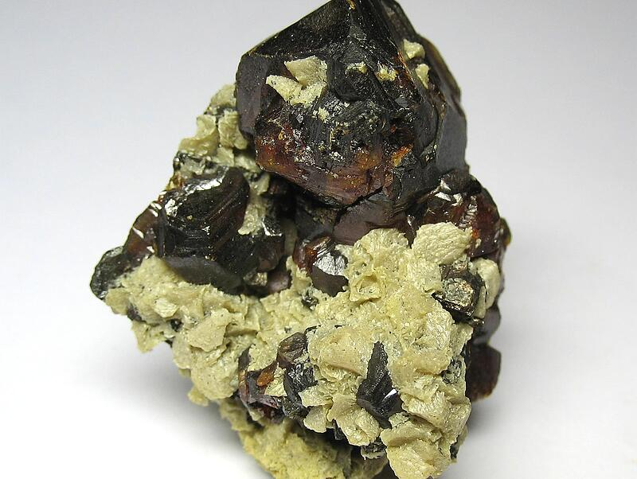

---
tags:
  - minerales
---

| Tipo            | Mejores marcas de campo                                     | Formula   | Especies similares                                                                                                                                                            | Ambiente                                                                                                                                                                                                                                                                                                                                    | Observaciones                                       | Depósitos                                                                                                                                               | Asociación                                                                                               |
| --------------- | ----------------------------------------------------------- | --------- | ----------------------------------------------------------------------------------------------------------------------------------------------------------------------------- | ------------------------------------------------------------------------------------------------------------------------------------------------------------------------------------------------------------------------------------------------------------------------------------------------------------------------------------------- | --------------------------------------------------- | ------------------------------------------------------------------------------------------------------------------------------------------------------- | -------------------------------------------------------------------------------------------------------- |
| Sulfuro de zinc | Color rojo-marrón a verde, brillo adamantino y exfoliación. | $$ ZnS $$ | La esfalerita no es tan pesada como la galena y carece de la exfoliación cúbica. La esfalerita es más pesada que la siderita, que tiene solo tres direcciones de exfoliación. | La esfalerita comparte muchos entornos con la galena. Ocurre con galena, fluorita y cerusita en carbonatitas y depósitos sedimentarios (de piedra caliza); con galena, arsenopirita y cuarzo en vetas hipotermales y mesotermales; y con galena, pirita y calcopirita en depósitos masivos, de veta y de reemplazo hidrotermal diseminados. | generalmente con algo de hierro, manganeso y cadmio | Se forma en una amplia variedad de condiciones hidrotermales, desde bajas hasta altas temperaturas; en carbón, caliza y otros yacimientos sedimentarios | Galena, calcopirita, marcasita, pirita, fluorita, barita, cuarzo y muchos otros minerales hidrotermales. |

| Color                                                                                         | Raya                                     | Brillo                | Clivaje (exfoliación)      | Dureza relativa (escala de Mohs) | Tenacidad | Peso específico | Diafanidad                                                 | Hábito, morfología o forma cristalina.                                                                                                                                                                                                                       | Fractura  | Sistema cristalino |
| --------------------------------------------------------------------------------------------- | ---------------------------------------- | --------------------- | -------------------------- | -------------------------------- | --------- | --------------- | ---------------------------------------------------------- | ------------------------------------------------------------------------------------------------------------------------------------------------------------------------------------------------------------------------------------------------------------ | --------- | ------------------ |
| Muy variable: desde incoloro a marrón oscuro, gris, negro, comunmente marrón, amarillo, negro | Marrón palido a amarillo y blanco pálido | Resinoso a adamantino | Perfecto, seis direcciones | 3.5 - 4.0                        | Frágil    | 3.9 - 4.1       | Transparente a translucido, opaco cuando es rico en hierro | Cristales tetraédricos, dodecaédricos, normalmente complejos y deformados; son frecuentes las caras curvas y cónicas; de hasta 30 cm. También se presenta en forma fibrosa, botrioidal, estalactítica, con clivaje, de granulometría gruesa a fina y masiva. | Concoidal | Isométrico         |

| imagen                               | nota                                                                                                                                                                                                                                                                                                                                                                  |
| ------------------------------------ | --------------------------------------------------------------------------------------------------------------------------------------------------------------------------------------------------------------------------------------------------------------------------------------------------------------------------------------------------------------------- |
|  | [  ### Sphalerite  Dulcinea de Llampos Mine, Cachiyuyo de Llampos mining district, Copiapó, Copiapó Province, Atacama, Chile  sphalerite. size: 40x35x25 mm. photo: 01-09-2013.  © Philip Bluemner      ](https://www.mindat.org/photo-509432.html) |

