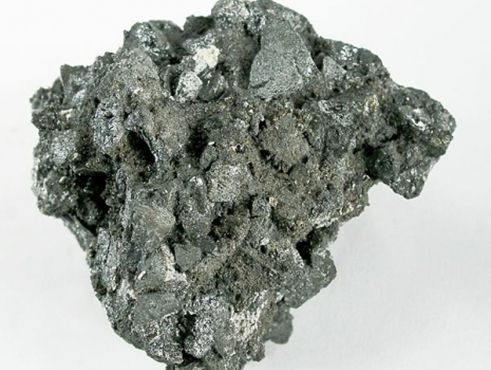

---
tags:
  - minerales
---

| Tipo     | Mejores marcas de campo | Formula | Especies similares | Ambiente | Observaciones                                             | Depósitos        | Asociación                                                                       |
| -------- | ----------------------- | ------- | ------------------ | -------- | --------------------------------------------------------- | ---------------- | -------------------------------------------------------------------------------- |
| Sulfosal |                         | $$  $$  |                    |          | Forma una serie con la tetraedrita y la argentotennantita | en hidrotermales | Una amplia variedad de sulfuros y sulfosales, como en el caso de la tetraedrita. |

| Color        | Raya | Brillo   | Clivaje (exfoliación) | Dureza relativa (escala de Mohs) | Tenacidad | Peso específico | Diafanidad | Hábito, morfología o forma cristalina. | Fractura | Sistema cristalino |
| ------------ | ---- | -------- | --------------------- | -------------------------------- | --------- | --------------- | ---------- | -------------------------------------- | -------- | ------------------ |
| Gris a negro |      | Metalico |                       |                                  |           | 5.4             | Opaco      | Tetrahedarales                         |          | Cúbico             |

| imagen                               | nota                                                                                                                                                                                                                                                                                                                                                                                                                                                                                                                                                                                                                                                                                                  |
| ------------------------------------ | ----------------------------------------------------------------------------------------------------------------------------------------------------------------------------------------------------------------------------------------------------------------------------------------------------------------------------------------------------------------------------------------------------------------------------------------------------------------------------------------------------------------------------------------------------------------------------------------------------------------------------------------------------------------------------------------------------- |
|  | [  ### Freibergite Subgroup  Ánimas Mine, Chocaya-Animas mining district, Atocha Municipality, Sud Chichas Province, Potosí, Bolivia  4.8 x 4.8 x 4.1 cm. Freibergite specimens from the Animas Mine are rare and are very rarely on the market in good quality, although known. This showy and very rich silver ore specimen is composed entirely of splendent, battleship-gray freibergite crystals to 1.0 cm. Old-time, classic sulfosalt material from the Rock Currier Collection. This is a ...  © Rob Lavinsky & irocks.com      ](https://www.mindat.org/photo-295930.html) |

