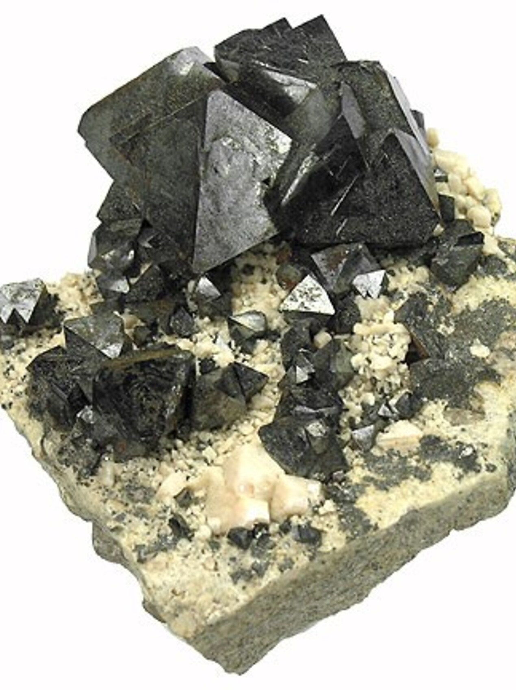

---
tags:
  - minerales
---
| Tipo            | Mejores marcas de campo   | Formula           | Especies similares                                                                                         | Ambiente                                                                                                                                                                                                                                                                                                                                                                                                                                                                                                                                                                                                                                                                                                                                                            | Obs.                                                                                                                                   |
| --------------- | ------------------------- | ----------------- | ---------------------------------------------------------------------------------------------------------- | ------------------------------------------------------------------------------------------------------------------------------------------------------------------------------------------------------------------------------------------------------------------------------------------------------------------------------------------------------------------------------------------------------------------------------------------------------------------------------------------------------------------------------------------------------------------------------------------------------------------------------------------------------------------------------------------------------------------------------------------------------------------- | -------------------------------------------------------------------------------------------------------------------------------------- |
| Óxido de hierro | Magnetismo y raya oscura. | $$ Fe_{3}O_{4} $$ | La magnetita tiene una raya más oscura que la ilmenita y es más magnética que la cromita y la franklinita. | La magnetita es uno de los minerales de óxido más abundantes y extendidos, y se encuentra en una amplia variedad de entornos. En general, es un componente habitual de muchas rocas ígneas, como la diorita, el gabro, la monzonita y la sienita nefelínica, así como de numerosas rocas sedimentarias clásticas. Más concretamente, se encuentra asociada a la hedenbergita y a la andradita en los hornfels de las rocas metamórficas de contacto; a la almandina, el talco y la andradita en los esquistos talcosos y las cuarcitas de las rocas metamórficas regionales; a la calcita, la andradita y la clorita en los skarns de las rocas metamórficas hidrotermales; y con barita y fluorita en yacimientos de sustitución hidrotermal masivos y en filones. | 1. a veces contiene pequeñas cantidades de manganeso, níquel, cromo y titanio 2. puede tener  octaédrico en cuatro direcciones.  |

| Color        | Raya  | Brillo   | Clivaje (exfoliación) | Dureza relativa (escala de Mohs) | Tenacidad | Peso específico | Diafanidad | Hábito, morfología o forma cristalina.                                                                                | Fractura      | Sistema cristalino |
| ------------ | ----- | -------- | --------------------- | -------------------------------- | --------- | --------------- | ---------- | --------------------------------------------------------------------------------------------------------------------- | ------------- | ------------------ |
| Negro-hierro | Negra | Metálico | Ninguno               | 5.5 - 6.5                        | Frágil    | 4.9 - 5.2       | Opaque     | generalmente octaedros, a veces dodecaedros con estriaciones; también masivos, gruesos o finos granulados, lamelares. | subconchoidal | Isometrico         |

| imagen                               | nota                                                                                                                                                                                                                                                                                                                                                                                                                                                                                                                                                              |
| ------------------------------------ | ----------------------------------------------------------------------------------------------------------------------------------------------------------------------------------------------------------------------------------------------------------------------------------------------------------------------------------------------------------------------------------------------------------------------------------------------------------------------------------------------------------------------------------------------------------------- |
|  | Magnetite  Cerro Huañaquina, Yocalla Municipality, Tomás Frías Province, Potosí, Bolivia  3.3 x 3.3 x 1.6 cm. Typically the Magnetite specimens from this locality are closely grown together, but this piece has great isolation between the crystals. These are also some of the finest quality crystals I’ve seen from this locality in a few years. The piece has excellent quality, good size, razor sharp, lustrous, black, metallic, ...  © Rob Lavinsky & irocks.com      ](https://www.mindat.org/photo-152231.html) |
