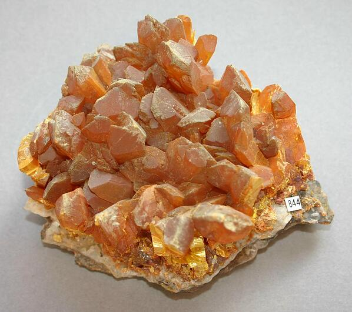

---
tags:
  - minerales
---
| Tipo                   | Mejores marcas de campo             | Formula           | Especies similares                                         | Ambiente                                                                                                                                   |
| ---------------------- | ----------------------------------- | ----------------- | ---------------------------------------------------------- | ------------------------------------------------------------------------------------------------------------------------------------------ |
| Trisulfuro de arsénico | Clivaje con brillo perlado y color. | $$ As_{2}S_{3} $$ | El azufre no tiene la exfoliación perfecta del oropimente. | El oropimente se desarrolla junto con cinabrio, realgar y calcita en vetas epitermais. También se forma como una sublimación en fumarolas. |

| Color                      | Raya           | Brillo             | Clivaje (exfoliación) | Dureza relativa (escala de Mohs) | Tenacidad | Peso específico | Diafanidad                 | Hábito, morfología o forma cristalina.                                                   | Fractura | Sistema cristalino | Obs. |
| -------------------------- | -------------- | ------------------ | --------------------- | -------------------------------- | --------- | --------------- | -------------------------- | ---------------------------------------------------------------------------------------- | -------- | ------------------ | ---- |
| Amarillo limón, anaranjado | amarillo-limón | Perlado en clivaje | Bueno, una dirección  | 1.5 -2                           | Sectil    | 3.4 - 3.5       | Translucido a transparante | cristales mal formados raros; generalmente incrustaciones foliadas, granulares, terrosas |          | Monoclinico        |      |

| imagen                               | nota                                                                                                                        |
| ------------------------------------ | --------------------------------------------------------------------------------------------------------------------------- |
|  | [Quiruvilca Mine, Quiruvilca District, Santiago de Chuco Province, La Libertad, Peru](https://www.mindat.org/loc-2558.html) |
