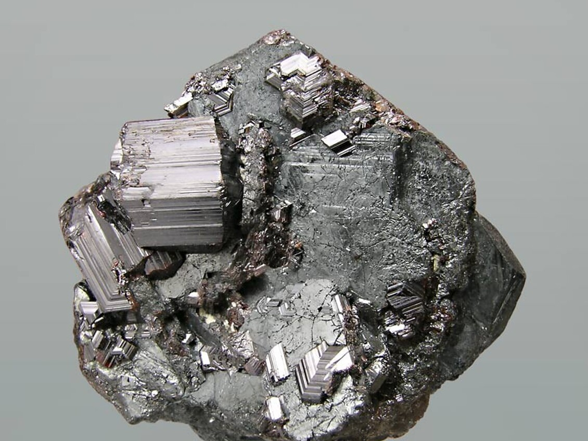
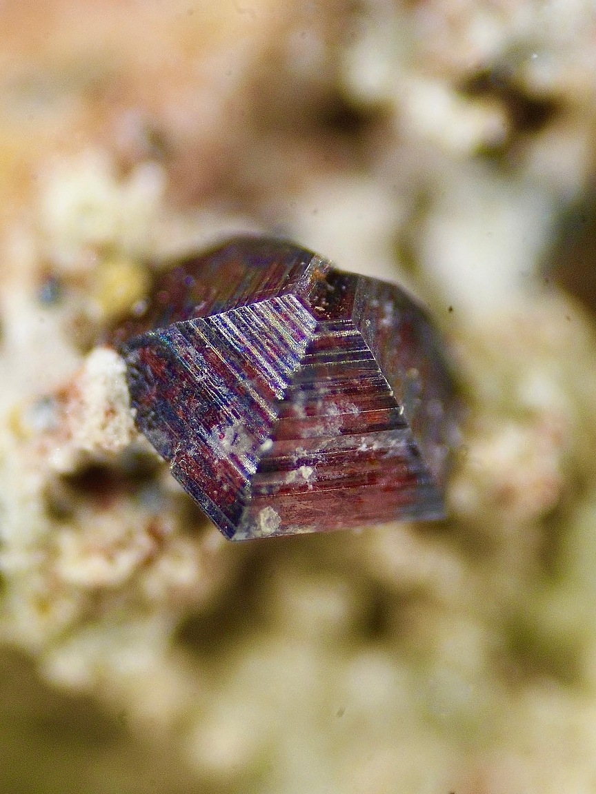

---
tags:
---

| Tipo               | Mejores marcas de campo                                    | Formula      | Especies similares                                                                                  | Ambiente                                                                                                                                                                                                                                                                  | Observaciones                                    |
| ------------------ | ---------------------------------------------------------- | ------------ | --------------------------------------------------------------------------------------------------- | ------------------------------------------------------------------------------------------------------------------------------------------------------------------------------------------------------------------------------------------------------------------------- | ------------------------------------------------ |
| Dióxido de titanio | Gravedad, cristales maclados y estriados, y fuerte brillo. | $$ TiO{2} $$ | La casiterita es más pesada y carece de los cristales prismáticos estriados y lustrosos del rutilo. | El rutilo se forma en rocas plutónicas y metamórficas. Se asocia con ortoclasa, barita y acmita en carbonatitas; con albita, lawsonita y glaucofana en esquistos azules de rocas metamórficas regionales; y con pirofílita en depósitos masivos de reemplazo hidrotermal. | puede contener cantidades sustanciales de hierro |

| Color                           | Raya                        | Brillo               | Clivaje (exfoliación)                                                    | Dureza relativa (escala de Mohs) | Tenacidad | Peso específico | Diafanidad   | Hábito, morfología o forma cristalina.                                                                                                    | Fractura                                    | Sistema cristalino |
| ------------------------------- | --------------------------- | -------------------- | ------------------------------------------------------------------------ | -------------------------------- | --------- | --------------- | ------------ | ----------------------------------------------------------------------------------------------------------------------------------------- | ------------------------------------------- | ------------------ |
| Rojo sangre, rojo-marrón, negro | Blanca, gris, marrón pálido | Adamantino, metálico | Definida, algunas veces buena, en dos direcciones; pobre en una tercera. | 6 - 6.5                          | Frágil    | 4.2 - 4.3       | Transparente | comúnmente cristales prismáticos largos y estriados; gemelos en forma de rodilla y en roseta; también aciculares, compactos, diseminados. | Irregular/desigual, concoidal, subconcoidal | Tetragonal.        |

| imagen                               | nota                                                                                                                                                                                                                                                                                                                                                                                                                        |
| ------------------------------------ | --------------------------------------------------------------------------------------------------------------------------------------------------------------------------------------------------------------------------------------------------------------------------------------------------------------------------------------------------------------------------------------------------------------------------- |
|  | [Rutile, Hematite, Ilmenite  Mwinilunga District, North-Western Province, Zambia  Epitaxial growth of red brilliant twinned Rutile on a doubly tabular former Ilmenite crystal pseudomorphed by Rutile and Hematite.Mwinilunga, Zambia.Found in 05/2007Specimen size: 3.8 x 3.3 x 2 cm  © Fabre Minerals https://www.fabreminerals.com      ](https://www.mindat.org/photo-144225.html) |
|  | [  ### Rutile  Tucumana-Delirio pit, Delirio mine, San Pedro de Cachiyuyo mining district, Diego de Almagro, Chañaral Province, Atacama, Chile  © Alejandro Castro Villafaña      ](https://www.mindat.org/photo-1294408.html)                                                                                  |