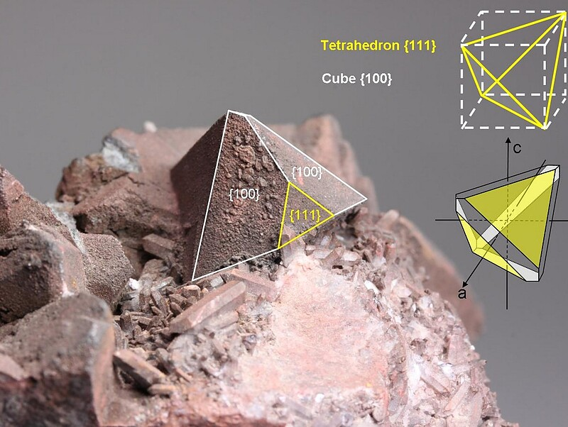

---
tags:
  - minerales
---
| Tipo                                                                                                                             | Mejores marcas de campo                                                              | Formula                                                                                          | Especies similares                                                                                                                                                                    | Ambiente                                                                                                                                                                                                                                                                                                |
| -------------------------------------------------------------------------------------------------------------------------------- | ------------------------------------------------------------------------------------ | ------------------------------------------------------------------------------------------------ | ------------------------------------------------------------------------------------------------------------------------------------------------------------------------------------- | ------------------------------------------------------------------------------------------------------------------------------------------------------------------------------------------------------------------------------------------------------------------------------------------------------- |
| Una serie de dos miembros que consiste en tetrahedrita, el miembro rico en antimonio, y tennantita, el miembro rico en arsénico. | Forma tetraédrica de los cristales, fractura casi conchoidal y falta de exfoliación. | $$ Cu_{12}Sb_{4}S_{13} ; (Cu,Fe)_{12}As_{4}S_{13}$$ Tetrahidrita y Tenantina, respectivamente | La enargita forma cristales tabulares y prismáticos; la calcopirita es de color amarillo latón, y la esfalerita tiene una excelente exfoliación, que está ausente en la tetrahedrita. | La tetrahedrita y la tennantita son minerales comunes que contienen cobre y se forman en varios entornos. Ocurren con galena y bornita en carbonatitas; con pirita, cuarzo y calcopirita en vetas mesotermales y epitermales; y con pirita y calcopirita en depósitos masivos de reemplazo hidrotermal. |

| Color                     | Raya        | Brillo   | Clivaje (exfoliación) | Dureza relativa (escala de Mohs) | Tenacidad | Peso específico | Diafanidad | Hábito, morfología o forma cristalina.                                                                               | Fractura                     | Sistema cristalino | Obs. |
| ------------------------- | ----------- | -------- | --------------------- | -------------------------------- | --------- | --------------- | ---------- | -------------------------------------------------------------------------------------------------------------------- | ---------------------------- | ------------------ | ---- |
| Gris acero a negro hierro | gris oscura | Metálico | Ninguno               | 3 - 4                            | Frágil    | 4.6 - 5.1       | Opaco      | predominantemente en tetraedros; a veces en grupos de cristales paralelos; también compacto, de grano grueso a fino. | De irregular a sub-concoidal | Isométrico         |      |

| imagen                               | nota                                                                                                                                                                                                                                                                                                                                                                                                                                                                 |
| ------------------------------------ | -------------------------------------------------------------------------------------------------------------------------------------------------------------------------------------------------------------------------------------------------------------------------------------------------------------------------------------------------------------------------------------------------------------------------------------------------------------------- |
|  | Tennantite Subgroup  Tsumeb Mine, Tsumeb, Oshikoto Region, Namibia  Sharp big tennanite crystals, up to 35 mm in size. The dominant form is the tetrahedron {111}, with edges modified by the cube {100}. Old tsumeb specimen form the Tichelman collection (Holland), who transfered it to Dr. Gerard Vogel (Holland) in 1989. Main crystal edge: 37mm.  © Price Down Minerals      ](https://www.mindat.org/photo-639373.html) |
